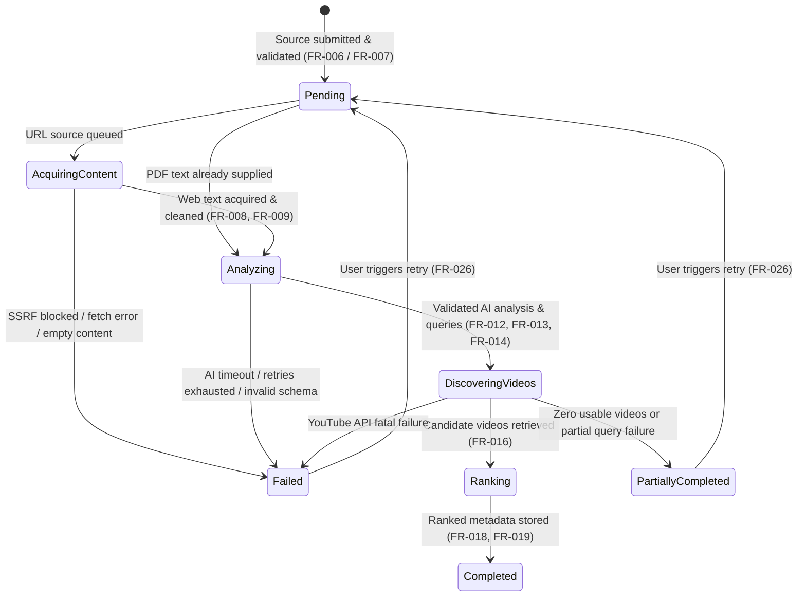

# EduScroll — Software Requirements Specification (SRS)

- **Document Version:** 0.1
- **Status:** Draft — Pending Product Owner Review & Approval
- **Work Package:** WP-03 (Requirements Engineering)
- **Structural Reference:** ISO/IEC/IEEE 29148:2018 *(used solely as a structural guide; this document does not claim formal compliance or certification)*
- **Last Updated:** 2026-11-17

---

## 1. Introduction
### 1.1 Purpose
This Software Requirements Specification (SRS) defines the product scope, stakeholders, operating context, functional and non-functional requirements, security and privacy controls, business rules, system states, and acceptance criteria for the **EduScroll** MVP. It serves as the authoritative baseline for Sprint 1–12 engineering and verification once approved by the Product Owner.

### 1.2 Document Conventions & Classification
All statements in this SRS and companion documents follow strict anti-hallucination classifications:
- **CONFIRMED:** Established in the Sprint 0 project brief or verified in the repository.
- **PROPOSED:** Engineering recommendation awaiting Product Owner approval.
- **ASSUMPTION — Requires Confirmation:** Working assumption explicitly flagged in [PROJECT-DECISIONS.md](file:///C:/Users/Obad/Desktop/EduScroll/docs/PROJECT-DECISIONS.md).
- **TBD — Requires Product Owner Decision:** Missing parameter, threshold, or policy decision (`TBD-001`–`TBD-024`).

---

## 2. Product Scope
EduScroll transforms user-submitted educational PDFs (locally extracted text) and public web page URLs (backend-fetched text) into structured educational analyses and a ranked vertical feed of embeddable YouTube educational videos. Full vision and MoSCoW scope boundaries are defined in [product-vision.md](file:///C:/Users/Obad/Desktop/EduScroll/docs/00-product/product-vision.md) and [product-scope.md](file:///C:/Users/Obad/Desktop/EduScroll/docs/00-product/product-scope.md).

---

## 3. Definitions and Abbreviations
| Term | Definition |
|---|---|
| **API** | Application Programming Interface (REST over HTTP/HTTPS). |
| **Clean Architecture** | Layered backend architecture separating Domain, Application, Infrastructure, and API/Web presentation (`WP-05`). |
| **DTO** | Data Transfer Object used at API boundaries. |
| **EF Core** | Entity Framework Core ORM for .NET (`CONFIRMED` intended ORM). |
| **Embeddable Video** | A YouTube video permitted by its uploader and YouTube API metadata (`status.embeddable`) to play inside an authorized embedded player. |
| **JWT** | JSON Web Token used for stateless Bearer authentication. |
| **MVP** | Minimum Viable Product. |
| **ORM** | Object-Relational Mapper. |
| **PII** | Personally Identifiable Information (e.g., email address, user identifiers). |
| **Source** | An educational input submitted by a user (either locally extracted PDF text or a public web URL). |
| **SSRF** | Server-Side Request Forgery. |
| **TBD** | To Be Determined — requires Product Owner decision. |

---

## 4. Stakeholders
Defined in [stakeholders.md §1](file:///C:/Users/Obad/Desktop/EduScroll/docs/00-product/stakeholders.md): Product Owner (**CONFIRMED**), End Users / Learners (**CONFIRMED**), Engineering Team (**CONFIRMED**), Operations / DevOps Maintainer (**PROPOSED**), and External Platform Providers — Google/YouTube (**CONFIRMED**) & Hosted LLM Provider if adopted (**PROPOSED**).

---

## 5. User Classes
Defined in [stakeholders.md §2](file:///C:/Users/Obad/Desktop/EduScroll/docs/00-product/stakeholders.md): Unauthenticated Visitor (**CONFIRMED**) and Authenticated Learner (`ASM-001`, `DEC-P09`). No paid tiers, instructor roles, or in-app admin roles are defined for MVP (`TBD` if requested).

---

## 6. Operating Environment
- **Backend Runtime (**CONFIRMED**):** ASP.NET Core 10 (`net10.0` verified in `src/*/*.csproj`), hosted in a production-oriented environment (`TBD-011`) with CI/CD.
- **Database (**CONFIRMED**):** PostgreSQL accessed via Entity Framework Core.
- **Client Runtime (**CONFIRMED / TBD**):** Flutter mobile application; exact target OS versions and desktop/web inclusion are `TBD-003` (`ASM-002`).
- **AI Inference (**CONFIRMED Initial / PROPOSED Prod**):** Local Ollama (`http://localhost:11434` observed in `appsettings.json`) for development/initial provider, abstracted behind `IAiAnalysisProvider` (`ADR-003`, `TBD-012`).
- **External Video Service (**CONFIRMED**):** YouTube Data API v3 (discovery/metadata) and policy-compliant YouTube embedded playback (`ADR-006`).

---

## 7. Product Perspective
EduScroll is a greenfield client-server system (with an existing .NET 10 solution skeleton in `src/` containing conflicts `CONF-001`–`CONF-003` awaiting resolution). It depends on external YouTube APIs for video metadata/playback and an abstracted LLM provider for educational concept extraction. System overview and layer boundaries are detailed in [system-overview.md](file:///C:/Users/Obad/Desktop/EduScroll/docs/03-architecture/system-overview.md).

---

## 8. Functional Requirements
Defined atomically with acceptance criteria in [functional-requirements.md](file:///C:/Users/Obad/Desktop/EduScroll/docs/01-requirements/functional-requirements.md):
- **Auth & Session:** `FR-001` – `FR-004`
- **Source Submission & Acquisition:** `FR-005` – `FR-010`
- **AI Analysis & Query Generation:** `FR-011` – `FR-015`
- **Video Discovery, Ranking & Metadata Storage:** `FR-016` – `FR-019`
- **Feed, Playback & Source Management:** `FR-020` – `FR-023`
- **Status, Error Handling & Recovery:** `FR-024` – `FR-026`
- **Conditional Should-Have:** `FR-027` – `FR-029`

---

## 9. External Interface Requirements
- **User Interface:** Flutter mobile application supporting auth flows, PDF picker + local extraction feedback, URL input, processing status indicators, vertical short-video feed with embedded YouTube player, and source library/revisit screens ([flutter-architecture.md](file:///C:/Users/Obad/Desktop/EduScroll/docs/03-architecture/flutter-architecture.md)).
- **Software / API Interface:** Versioned REST JSON API over HTTPS with JWT Bearer authentication and `ProblemDetails` error responses ([integration-design.md](file:///C:/Users/Obad/Desktop/EduScroll/docs/03-architecture/integration-design.md)). Final route paths and DTO schemas are deferred until Sprint 1/4 contract approval.
- **External Service Interfaces:**
  1. AI Provider HTTP interface (initial: Ollama API; abstracted via Application port, [ai-pipeline.md](file:///C:/Users/Obad/Desktop/EduScroll/docs/04-ai/ai-pipeline.md)).
  2. YouTube Data API v3 (`search.list`, `videos.list`, etc., [discovery-design.md](file:///C:/Users/Obad/Desktop/EduScroll/docs/05-video-discovery/discovery-design.md)).
  3. Public HTTP/HTTPS Web Servers (read-only `GET` with SSRF guardrails, `SEC-006`).

---

## 10. Data Requirements
Conceptual candidate entities (`User`, `Source`, `SourceAnalysis`, `Topic`, `SearchQuery`, `DiscoveredVideo`, `SourceVideoRecommendation`, and conditional `Bookmark`, `ViewingHistory`), ownership rules, sensitivity classifications, and retention `TBD-019` items are specified in [conceptual-data-model.md](file:///C:/Users/Obad/Desktop/EduScroll/docs/06-data/conceptual-data-model.md).

---

## 11. Non-Functional Requirements
Defined in [non-functional-requirements.md §1](file:///C:/Users/Obad/Desktop/EduScroll/docs/01-requirements/non-functional-requirements.md): `NFR-001` – `NFR-010`.

---

## 12. Security Requirements
Defined in [non-functional-requirements.md §2](file:///C:/Users/Obad/Desktop/EduScroll/docs/01-requirements/non-functional-requirements.md): `SEC-001` – `SEC-011`, supported by STRIDE threat modeling in [initial-threat-analysis.md](file:///C:/Users/Obad/Desktop/EduScroll/docs/07-security/initial-threat-analysis.md).

---

## 13. Privacy Requirements
Defined in [non-functional-requirements.md §3](file:///C:/Users/Obad/Desktop/EduScroll/docs/01-requirements/non-functional-requirements.md): `SEC-012` – `SEC-015` (log hygiene, data minimization, retention/deletion, and external AI disclosure).

---

## 14. Business Rules
Defined in [non-functional-requirements.md §4](file:///C:/Users/Obad/Desktop/EduScroll/docs/01-requirements/non-functional-requirements.md): `BR-001` – `BR-008`.

---

## 15. System States
A submitted `Source` progresses through explicit lifecycle states (**PROPOSED — `DEC-P04`**):

---

## 16. Error Handling
- **Validation Errors:** Rejected synchronously at API/client boundary with `ProblemDetails` (`400`/`422`) and field-level error codes without creating orphan processing jobs.
- **Security Rejections:** Authentication (`401`), ownership denial (`403`/`404` per IDOR policy), SSRF block (`400`/`422` without revealing internal IP/DNS diagnostics), rate limit (`429`).
- **Pipeline / Upstream Errors:** Bounded retries for transient AI or YouTube HTTP faults; non-retryable or exhausted faults transition the `Source` to `Failed` or `PartiallyCompleted` with a user-safe error code (`FR-024`, `FR-025`, `WF-15`).

---

## 17. Constraints and Assumptions
- **Non-Negotiable Constraints (1–15):** Captured in Brief §3 and mapped to `DEC-C04`–`DEC-C12` in [PROJECT-DECISIONS.md](file:///C:/Users/Obad/Desktop/EduScroll/docs/PROJECT-DECISIONS.md).
- **Working Assumptions:** `ASM-001`–`ASM-007` in [PROJECT-DECISIONS.md §4](file:///C:/Users/Obad/Desktop/EduScroll/docs/PROJECT-DECISIONS.md).

---

## 18. Acceptance Criteria
Atomic acceptance criteria are attached to each requirement in [functional-requirements.md](file:///C:/Users/Obad/Desktop/EduScroll/docs/01-requirements/functional-requirements.md) and [non-functional-requirements.md](file:///C:/Users/Obad/Desktop/EduScroll/docs/01-requirements/non-functional-requirements.md). Sprint-level exit acceptance criteria are defined in [sprint-roadmap.md](file:///C:/Users/Obad/Desktop/EduScroll/docs/09-roadmap/sprint-roadmap.md).

---

## 19. Traceability Matrix
Maintained in [traceability-matrix.md](file:///C:/Users/Obad/Desktop/EduScroll/docs/01-requirements/traceability-matrix.md).

---

## 20. Open Issues and TBD Decisions
All 24 unresolved decisions (`TBD-001`–`TBD-024`) and repository conflicts (`CONF-001`–`CONF-003`) are tracked in [PROJECT-DECISIONS.md](file:///C:/Users/Obad/Desktop/EduScroll/docs/PROJECT-DECISIONS.md).
