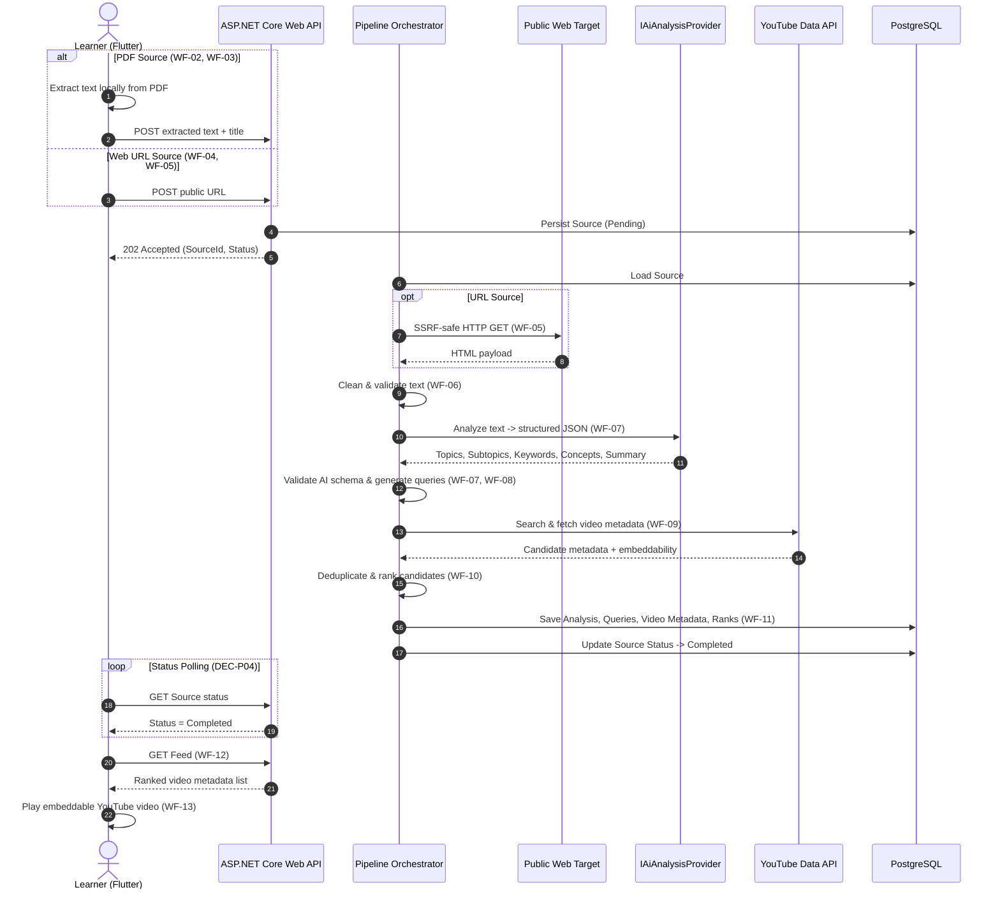

# EduScroll — System Workflows (WP-04)

- **Document Version:** 0.1
- **Status:** Draft — Pending Product Owner Review & Approval
- **Work Package:** WP-04 (System Workflow Analysis)
- **Last Updated:** 2026-11-17

---

## High-Level Processing Sequence Diagram

---

## WF-01: User Registration and Authentication
- **Trigger:** User submits registration, sign-in, token refresh, or sign-out action in Flutter.
- **Preconditions:** Network connectivity to HTTPS API; valid client input formatting.
- **Main Flow:**
  1. **Register:** User provides unique email/username and password -> API validates via ASP.NET Core Identity (`SEC-002`) -> creates user record -> obeys verification policy (`TBD-008`).
  2. **Sign-In:** User submits credentials -> Identity verifies password hash -> issues signed JWT access token (and refresh token per `DEC-P10`) -> Flutter persists tokens in OS secure storage (`SEC-005`).
  3. **Refresh / Sign-Out:** Client rotates expired access token via refresh endpoint or revokes refresh token and clears secure storage on sign-out.
- **Alternative Flows:** Password reset flow (`FR-029`, `TBD-008`) if approved.
- **Failure Scenarios:** Duplicate email (`409`), weak password (`400`), invalid credentials (`401` generic message), rate-limit exceeded (`429`, `SEC-011`), expired/revoked refresh token (`401` -> force re-login).
- **Expected System State:** Authenticated session established with JWT `sub` mapped to `UserId`; or clean unauthenticated state on logout/failure.
- **Data Created/Updated:** `User` record (registration); `RefreshToken` record if `DEC-P10` approved.
- **Requirements:** `FR-001`–`FR-004`, `SEC-001`, `SEC-002`, `SEC-004`, `SEC-005`, `SEC-011`.

---

## WF-02: PDF Submission
- **Trigger:** Authenticated learner selects a local PDF file in Flutter to generate a discovery feed.
- **Preconditions:** User is authenticated; OS storage/file-picker permission granted; file size within `TBD-005`.
- **Main Flow:**
  1. Flutter validates file extension/MIME and size (`TBD-005`).
  2. Invokes `WF-03` (local extraction).
  3. Displays optional title/preview and sends extracted UTF-8 text + title (no PDF binary per `BR-003`) to backend over HTTPS.
  4. Backend validates JWT (`SEC-001`), payload size (`TBD-005`), creates `Source` (`Pending`), enqueues `WF-06`, returns `202` with `SourceId`.
- **Alternative Flows:** User cancels during local extraction or edits display title before upload.
- **Failure Scenarios:** Oversized PDF (`TBD-005`), unsupported/encrypted PDF (`TBD-006`), empty extracted text, network failure, `401`/`429`.
- **Expected System State:** `Source` persisted in `Pending` (or `Analyzing`) state owned by user; raw PDF remains solely on user device.
- **Data Created/Updated:** `Source` (type `PDF`, title, extracted text, owner `UserId`, status).
- **Requirements:** `FR-005`, `FR-006`, `FR-010`, `FR-024`, `BR-003`, `SEC-007`, `SEC-013`.

---

## WF-03: PDF Text Extraction
- **Trigger:** Initiated by `WF-02` after user picks a local PDF in Flutter.
- **Preconditions:** Readable local PDF file handle on device (`ASM-002`, `ASM-003`).
- **Main Flow:**
  1. Flutter PDF extraction service opens PDF stream locally on device (off UI isolate/thread where supported).
  2. Extracts text page-by-page in reading order up to `TBD-005` character cap.
  3. Normalizes basic control characters and checks non-empty text threshold.
  4. Returns extracted string to `WF-02` submission controller.
- **Alternative Flows:** Partial extraction if document exceeds max character threshold (`TBD-005`, `TBD-013` — truncate with notice vs. reject).
- **Failure Scenarios:** Password-protected PDF (`TBD-006`), corrupted PDF stream, image-only/scanned PDF yielding zero characters (`ASM-003`, `TBD-006`).
- **Expected System State:** Extracted text held in memory only long enough to transmit in `WF-02`; zero raw binary uploaded.
- **Data Created/Updated:** None persisted on backend directly by this step; transient client memory only.
- **Requirements:** `FR-005`, `BR-003`, `SEC-013`, `NFR-010`.

---

## WF-04: Web URL Submission
- **Trigger:** Authenticated learner submits a web page URL in Flutter.
- **Preconditions:** Authenticated session; non-empty URL input.
- **Main Flow:**
  1. Flutter performs basic URL syntax check (`http`/`https`) and posts URL to backend.
  2. Backend validates JWT (`SEC-001`), rate limits (`SEC-011`), URL syntax, allowed scheme (`http`/`https` only), and initial SSRF pre-check (`SEC-006`).
  3. Backend creates `Source` (`Pending`), enqueues acquisition (`WF-05`), and returns `202` with `SourceId`.
- **Alternative Flows:** User supplies optional custom title.
- **Failure Scenarios:** Non-HTTP scheme (`file://`, `ftp://`, `javascript:`), malformed URL, private/localhost URL blocked (`400`/`422`), rate limit (`429`).
- **Expected System State:** `Source` created in `Pending` state for valid public URLs; rejected requests create no processing job.
- **Data Created/Updated:** `Source` (type `WebUrl`, normalized URL, owner `UserId`, status `Pending`).
- **Requirements:** `FR-007`, `FR-024`, `BR-004`, `SEC-006`, `SEC-007`.

---

## WF-05: Web Content Acquisition
- **Trigger:** Background worker picks up a `Pending` `WebUrl` source (`WF-04`).
- **Preconditions:** `Source` exists with `Status == Pending` and valid URL.
- **Main Flow:**
  1. Transition `Source` -> `AcquiringContent`.
  2. Resolve target hostname DNS and verify all resolved IPs are public unicast (blocking loopback, RFC1918, link-local `169.254.0.0/16`, IPv6 ULA/loopback, multicast).
  3. Connect directly to validated IP with SNI/Host header (preventing DNS rebinding), enforcing strict timeout and max response byte limit (`TBD-005`).
  4. Manually handle redirects up to a small hop limit, re-running SSRF IP/scheme validation on every redirect location.
  5. Verify `Content-Type` is HTML/text (`TBD-007`), extract main readable article text, strip `<script>`, `<style>`, navigation boilerplate.
  6. Pass cleaned text to `WF-06`.
- **Alternative Flows:** Direct PDF URL or non-HTML content (`TBD-007`).
- **Failure Scenarios:** SSRF violation on DNS/redirect, connection timeout, HTTP 4xx/5xx (e.g., paywall/403 per `TBD-007`), oversized response, JS-only SPA returning empty body (`TBD-007`).
- **Expected System State:** `Source` transitions to `Analyzing` (via `WF-06`) or `Failed` with sanitized error code (no internal IP/network leaks).
- **Data Created/Updated:** `Source.ExtractedText`, `Source.Title` (if inferred from `<title>`), `Source.Status`.
- **Requirements:** `FR-008`, `FR-025`, `BR-004`, `SEC-006`, `NFR-003`.

---

## WF-06: Source Validation
- **Trigger:** Text received from `WF-02` (PDF) or `WF-05` (Web URL).
- **Preconditions:** Raw extracted text available in backend Application pipeline.
- **Main Flow:**
  1. Normalize Unicode/whitespace and strip control characters.
  2. Validate minimum meaningful text length and maximum length (`TBD-005`).
  3. Apply context-window sizing/chunking strategy (`TBD-013`).
  4. Persist cleaned text on `Source` (`TBD-019`) and transition to `Analyzing`.
- **Alternative Flows:** Long text truncated/chunked per approved `TBD-013` policy.
- **Failure Scenarios:** Insufficient readable text (e.g., cookie banner only or corrupted encoding), exceeds hard limit (`TBD-005`).
- **Expected System State:** Validated text ready for `WF-07`, or `Source` marked `Failed` (`INVALID_CONTENT`).
- **Data Created/Updated:** `Source.CleanedText` (or reference), `Source.Status`.
- **Requirements:** `FR-009`, `FR-010`, `SEC-007`.

---

## WF-07: AI Content Analysis
- **Trigger:** `Source` enters `Analyzing` state after `WF-06`.
- **Preconditions:** Validated cleaned text; configured `IAiAnalysisProvider` (e.g., Ollama).
- **Main Flow:**
  1. Application constructs versioned prompt separating system instructions from delimited untrusted source text (`SEC-009`).
  2. Calls `IAiAnalysisProvider` with timeout and structured JSON output enforcement.
  3. Parses response as untrusted input (`SEC-010`) and validates against strict JSON schema: required `summary`, `topics`, `subtopics`, `keywords`, `concepts`, array/string bounds.
  4. Persists `SourceAnalysis` and normalized `Topic` records (`WF-08` triggers next).
- **Alternative Flows:** Multi-chunk map-reduce analysis if `TBD-013` selects chunking.
- **Failure Scenarios:** Provider timeout/unavailable, invalid JSON/schema mismatch, prompt-injection corruption -> bounded retry (e.g., repair/re-prompt), then `Failed` (`AI_ANALYSIS_FAILED`) if exhausted.
- **Expected System State:** Validated `SourceAnalysis` stored and status transitions to `DiscoveringVideos`, or clean `Failed` state.
- **Data Created/Updated:** `SourceAnalysis`, `Topic` entities, `Source.Status`.
- **Requirements:** `FR-011`, `FR-012`, `FR-013`, `FR-015`, `BR-005`, `NFR-006`, `SEC-009`, `SEC-010`.

---

## WF-08: Search Query Generation
- **Trigger:** Validated `SourceAnalysis` produced by `WF-07`.
- **Preconditions:** Validated `topics`, `subtopics`, `keywords`, `concepts`.
- **Main Flow:**
  1. Generate bounded search query strings (`TBD-014`) either deterministically from validated analysis fields or via validated AI query-generation step (`WP-06`).
  2. Sanitize queries (strip operators/control characters, deduplicate similar queries, enforce max length and max count `TBD-014`).
  3. Persist `SearchQuery` records linked to `SourceAnalysis`.
- **Alternative Flows:** Fallback deterministic query builder from top keywords/topics if AI query step fails.
- **Failure Scenarios:** Zero valid queries generated -> mark `Failed` (`QUERY_GENERATION_FAILED`).
- **Expected System State:** `SearchQuery` list persisted and passed to `WF-09`.
- **Data Created/Updated:** `SearchQuery` records.
- **Requirements:** `FR-014`, `FR-015`, `BR-005`, `NFR-009`.

---

## WF-09: YouTube Video Discovery
- **Trigger:** `Source` enters `DiscoveringVideos` with generated `SearchQuery` list.
- **Preconditions:** Backend YouTube Data API credential configured (`SEC-008`); quota available (`TBD-015`).
- **Main Flow:**
  1. For each `SearchQuery` (within `TBD-014` budget), call YouTube Data API search endpoint with educational/short-video parameters (`TBD-016`) and `videoEmbeddable=true` (where supported).
  2. Collect unique candidate `YouTubeVideoId`s across all queries.
  3. Batch-fetch full video metadata (`videos.list`) for unique IDs to retrieve `title`, `description`, `channelTitle`, `duration`, `publishedAt`, `status.embeddable`, `status.privacyStatus`, thumbnails, and statistics.
  4. Filter out non-embeddable, private/deleted, or duration-excluded videos (`BR-002`, `TBD-016`).
- **Alternative Flows:** Reuse fresh cached metadata (`TBD-015`, `TBD-023`) if compliant with YouTube ToS caching TTL.
- **Failure Scenarios:** YouTube quota exceeded (`403 quotaExceeded`), network timeout, transient `5xx` -> bounded retry for transient errors; `PartiallyCompleted` if some queries succeed, or `Failed` (`DISCOVERY_FAILED`) if none succeed.
- **Expected System State:** Deduplicated, enriched, embeddable candidate video list passed to `WF-10`.
- **Data Created/Updated:** Candidate set in memory / `SearchQuery` execution status.
- **Requirements:** `FR-016`, `FR-017`, `BR-001`, `BR-002`, `NFR-003`, `NFR-009`, `SEC-008`.

---

## WF-10: Video Relevance Evaluation
- **Trigger:** Eligible candidate videos returned from `WF-09`.
- **Preconditions:** Validated `SourceAnalysis` + enriched candidate video metadata.
- **Main Flow:**
  1. Score each candidate against `SourceAnalysis` signals (`WP-07`: Topic Match, Concept Match, Title Match, Description Match, plus filtering/quality signals).
  2. Apply minimum relevance threshold (`TBD`) and sort descending; cap feed size per source (`TBD-014`).
- **Alternative Flows:** Optional AI re-ranking step if enabled and within latency/cost budget (`WP-06`, `WP-07`).
- **Failure Scenarios:** All candidates below relevance threshold -> transition `Source` to `PartiallyCompleted` (`NO_RELEVANT_VIDEOS`) so user can inspect summary or retry/adjust.
- **Expected System State:** Ordered list of scored `DiscoveredVideo` recommendations ready for `WF-11`.
- **Data Created/Updated:** Computed scores and rank positions (persisted in `WF-11`).
- **Requirements:** `FR-018`, `NFR-007`.

---

## WF-11: Video Metadata Storage
- **Trigger:** Ranked results produced by `WF-10`.
- **Preconditions:** Valid `Source` and ranked metadata-only video records.
- **Main Flow:**
  1. Begin database transaction.
  2. Upsert `DiscoveredVideo` metadata records keyed by `YouTubeVideoId` (storing metadata & references only per `BR-001`).
  3. Persist `SourceVideoRecommendation` linking `SourceId`, `DiscoveredVideoId`, relevance score, rank order, and matched topics/query reference.
  4. Transition `Source.Status` -> `Completed` (or `PartiallyCompleted` if partial).
  5. Commit transaction.
- **Alternative Flows:** Re-ranking/refresh replaces or updates existing `SourceVideoRecommendation` entries (`TBD-017`).
- **Failure Scenarios:** DB transient failure / concurrency conflict -> retry transaction; rollback ensures no half-written feed state.
- **Expected System State:** `Source` is `Completed` and feed is immediately queryable in `WF-12`.
- **Data Created/Updated:** `DiscoveredVideo`, `SourceVideoRecommendation`, `Source.Status`.
- **Requirements:** `FR-019`, `BR-001`, `FR-024`.

---

## WF-12: Feed Retrieval
- **Trigger:** Authenticated learner polls `Source` completion or opens the feed screen in Flutter.
- **Preconditions:** Valid JWT; `Source` owned by user (`SEC-003`) in `Completed` or `PartiallyCompleted` state (or unified feed per `TBD-017`).
- **Main Flow:**
  1. Flutter requests paginated feed (`page`/`cursor`, `pageSize`).
  2. Backend verifies ownership (`UserId == Source.UserId`) and returns ordered video metadata DTOs (YouTube video ID, title, channel, duration, rank, matched topics, source title/ID).
  3. Flutter updates feed state and preloads upcoming player metadata (without downloading video streams per `BR-001`).
- **Alternative Flows:** Empty feed state renders guidance and link to source analysis summary.
- **Failure Scenarios:** Unauthorized (`401`), non-owned source (`403`/`404`), source still processing (`202`/status info), transient network error -> client retry prompt.
- **Expected System State:** Paginated feed displayed in vertical scroll view.
- **Data Created/Updated:** Read-only (unless feed telemetry/history is enabled via `FR-028`).
- **Requirements:** `FR-020`, `SEC-003`, `BR-006`, `NFR-001`.

---

## WF-13: Video Playback
- **Trigger:** Learner scrolls to or taps a video item in the vertical feed.
- **Preconditions:** Network connectivity; valid `YouTubeVideoId` marked embeddable (`BR-002`).
- **Main Flow:**
  1. Flutter mounts/activates the compliant embedded YouTube player (`ADR-006`) for the active `YouTubeVideoId`.
  2. Player streams directly from YouTube servers with YouTube branding and controls visible (`BR-002`).
  3. Learner can pause/seek/toggle fullscreen, scroll to next video, or tap "View Source" (`WF-14`).
  4. *(Conditional `FR-028`, `TBD-018`)*: Client optionally reports watch event to backend.
- **Alternative Flows:** User taps "Open in YouTube" link provided by embedded player branding.
- **Failure Scenarios:** Video became unavailable, private, or embedding was disabled by uploader since discovery -> player error callback shows graceful "Video unavailable" card with skip-to-next and optional report/hide action.
- **Expected System State:** Smooth vertical single-active-player playback; zero local video media cached/stored by EduScroll.
- **Data Created/Updated:** None (unless `ViewingHistory` `FR-028` is approved).
- **Requirements:** `FR-021`, `BR-001`, `BR-002`, `FR-028` (`TBD-018`).

---

## WF-14: Source Management
- **Trigger:** Learner opens "My Sources" library, taps "View Source" from a feed video, or deletes a source.
- **Preconditions:** Authenticated user owning the target `Source` (`SEC-003`).
- **Main Flow:**
  1. **List Sources:** Backend returns paginated sources owned by `UserId` with type, title, created timestamp, and `Status`.
  2. **Revisit Source:** Backend verifies ownership and returns `SourceAnalysis` (summary, topics, subtopics, concepts, keywords) plus original public URL if `WebUrl` (`TBD-024` for PDF text preview).
  3. **Delete Source:** Backend verifies ownership and deletes the `Source` along with its `SourceAnalysis`, `SearchQuery`, and `SourceVideoRecommendation` records (`TBD-019`).
- **Alternative Flows:** User launches the source's feed directly from Source Detail view.
- **Failure Scenarios:** Accessing/deleting another user's `Source` (`403`/`404` per `SEC-003`); source not found (`404`).
- **Expected System State:** Accurate user-isolated source library; deleted sources are inaccessible immediately.
- **Data Created/Updated:** Read-only for list/detail; cascade delete on `Source` removal.
- **Requirements:** `FR-022`, `FR-023`, `SEC-003`, `SEC-014`, `BR-006`.

---

## WF-15: Error and Recovery Workflows
- **Trigger:** Timeout, transient HTTP error, schema validation failure, SSRF block, or user-initiated retry (`FR-026`).
- **Preconditions:** Existing `Source` or active pipeline execution.
- **Main Flow:**
  1. **Transient Failure (AI/YouTube/DB):** Infrastructure policy executes bounded retries with backoff (`NFR-003`).
  2. **Exhausted / Non-Retryable Failure:** Pipeline catches failure, logs structured diagnostics with correlation ID (`NFR-008`, excluding secrets/raw text per `SEC-012`), sets `Source.Status` to `Failed` or `PartiallyCompleted` with a safe error code (`FR-024`, `FR-025`).
  3. **User Recovery:** Flutter polls status, displays plain-language error guidance, and offers "Retry" (`FR-026`) when recoverable (re-queuing only failed/incomplete stage if prior validated state exists).
- **Alternative Flows:** Client offline during submission -> Flutter retains unsent text/URL locally until user retries.
- **Failure Scenarios:** Repeated retries hit rate limit (`429`) or persistent invalid content (`Failed` marked non-retryable).
- **Expected System State:** No stuck `Processing` jobs (watchdog/timeout guard), no partial corrupt DB state, clear user feedback.
- **Data Created/Updated:** `Source.Status`, `Source.FailureCode`, structured diagnostic logs.
- **Requirements:** `FR-024`, `FR-025`, `FR-026`, `NFR-003`, `NFR-008`, `SEC-012`.
