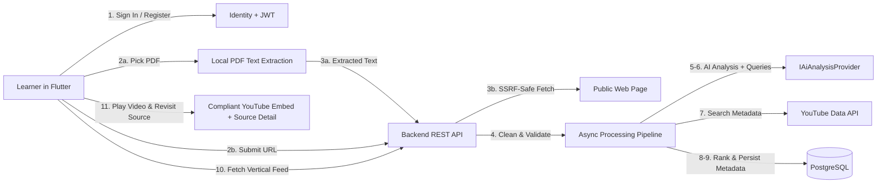

# EduScroll — Primary User Journey & Scenarios

- **Document Version:** 0.1
- **Status:** Draft — Pending Product Owner Review & Approval
- **Work Package:** WP-01 & WP-04
- **Last Updated:** 2026-11-17

---

## 1. Intended Primary User Journey (Preserved from Brief §1.3)

The 11-step intended workflow is preserved verbatim with Sprint 0 technical refinements annotated:

1. **The user creates an account or signs in.** (**CONFIRMED**) — Via Flutter auth UI against ASP.NET Core Identity + JWT (`WF-01`, `TBD-008`).
2. **The user submits an educational PDF or web URL.** (**CONFIRMED**) — Selects local PDF (`WF-02`) or pastes public HTTP/HTTPS URL (`WF-04`).
3. **The application extracts or obtains the source text.** (**CONFIRMED**) — PDF text is extracted locally in Flutter (`WF-03`, Constraint #3); web URL content is fetched securely by the backend with SSRF protection (`WF-05`, Constraints #5–#6).
4. **The backend processes the content.** (**CONFIRMED**) — Validates bounds, cleans text/HTML boilerplate, persists source record, and dispatches analysis (`WF-06`; asynchronous execution proposed per `DEC-P04`).
5. **The AI analysis component identifies topics, subtopics, keywords, concepts, and a summary.** (**CONFIRMED**) — Executed via AI provider abstraction and strictly validated against JSON schema (`WF-07`, Constraints #7–#8).
6. **The system generates search queries.** (**CONFIRMED**) — Derived from validated topics, concepts, and keywords within query budget bounds (`WF-08`, `TBD-014`).
7. **The video discovery component searches YouTube for candidate videos.** (**CONFIRMED**) — Executed server-side via YouTube Data API using backend secrets (`WF-09`, Constraint #11).
8. **The ranking component evaluates the relevance of candidate videos.** (**CONFIRMED**) — Filters non-embeddable/unavailable videos and scores relevance against source concepts (`WF-10`).
9. **The system stores the required source information and video metadata.** (**CONFIRMED**) — Stores metadata and YouTube references only, never video media files (`WF-11`, Constraint #1).
10. **The user receives an educational video feed.** (**CONFIRMED**) — Flutter polls/retrieves the paginated vertical feed scoped to the owning user (`WF-12`, Constraint #12).
11. **The user can watch relevant videos and revisit their sources.** (**CONFIRMED**) — Plays video in a YouTube policy-compliant embedded player (`WF-13`, Constraint #2) and navigates back to source summary/reference (`WF-14`, `TBD-024`).

### End-to-End Journey Overview Diagram

---

## 2. Main User Scenarios (**PROPOSED — Derived from Primary Journey**)

### Scenario A: Student Studying a Lecture PDF
- **Actor:** University student (`Learner`).
- **Flow:** Signs in -> selects a lecture PDF on their phone -> Flutter extracts text locally and shows extraction preview/progress -> submits extracted text -> sees source card transition `Pending` -> `Analyzing` -> `DiscoveringVideos` -> `Completed` -> opens vertical short-video feed -> watches concise explainer clips -> taps "View Source" to review the AI-generated summary and topic list (`TBD-024`).

### Scenario B: Self-Learner Reading a Technical Web Article
- **Actor:** Software engineer (`Learner`).
- **Flow:** Copies a public documentation/tutorial URL -> pastes into EduScroll -> backend validates URL against SSRF rules, fetches HTML, extracts article text, analyzes concepts, discovers and ranks YouTube clips -> learner watches top-ranked videos and opens the original URL link from the source detail view.

### Scenario C: Handling an Unusable Input or Upstream Failure
- **Actor:** Any `Learner`.
- **Sub-case C1 (Scanned/Empty PDF):** Flutter local extraction finds zero extractable text (`TBD-006`) -> user receives immediate on-device guidance without wasting backend/AI calls.
- **Sub-case C2 (Blocked/Private URL):** User submits `http://127.0.0.1` or an internal URL -> backend SSRF guard blocks request (`SEC-006`) -> returns safe validation error without leaking network details.
- **Sub-case C3 (AI/YouTube Timeout):** Upstream AI or YouTube quota/timeout exhausts retries -> source transitions to `Failed` or `PartiallyCompleted` -> user sees clear status and can tap "Retry" (`WF-15`).
