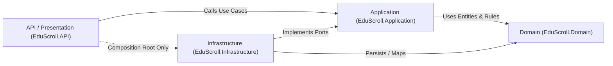

# EduScroll — Backend Architecture (Clean Architecture)

- **Document Version:** 1.0
- **Status:** Updated — Sprint 1 Backend Foundation Implemented
- **Work Package:** WP-05 (Backend Conceptual Architecture)
- **Last Updated:** 2026-11-17

---

## 1. Repository Baseline & Sprint 1 Resolution (`CONF-001`–`CONF-004`)

Following commit `b3a8f9e` (removing the legacy MVC scaffold) and Product Owner Sprint 1 approval, the backend solution was established under `backend/EduScroll.sln` with four `net10.0` source projects and four xUnit test projects:
- `backend/src/EduScroll.Domain` (zero project or framework dependencies)
- `backend/src/EduScroll.Application` (references `EduScroll.Domain` and `Microsoft.Extensions.DependencyInjection.Abstractions` `10.0.14`)
- `backend/src/EduScroll.Infrastructure` (references `EduScroll.Domain` and `EduScroll.Application`)
- `backend/src/EduScroll.API` (pure ASP.NET Core 10 Web API composition root; references `EduScroll.Application` and `EduScroll.Infrastructure`)

**Resolved Conflicts from Sprint 0:**
1. **`CONF-001` (`ADR-001` — Resolved):** Replaced legacy MVC project with pure ASP.NET Core 10 Web API (`EduScroll.API`).
2. **`CONF-002` (`ADR-002` — Resolved):** No backend `IPdfTextExtractor` created; PDF extraction remains client-side in Flutter per Constraint #3.
3. **`CONF-003` (Resolved):** Legacy malformed `appsettings.json` removed; Sprint 1 uses strongly-typed, startup-validated `ApiMetadataOptions` and `CorsOptions` (`backend-foundation-guide.md`).
4. **`CONF-004` (Resolved):** Added `EduScroll.Domain.Tests`, `EduScroll.Application.Tests`, `EduScroll.Architecture.Tests`, and `EduScroll.API.IntegrationTests` under `backend/tests/`.

---

## 2. Layer Responsibilities & Dependency Direction

### 2.1 Domain (`EduScroll.Domain`)
- **Dependency Rule (**CONFIRMED** — Constraint #10):** Zero dependencies on `Application`, `Infrastructure`, `API`, EF Core, Identity, or HTTP packages.
- **Owns:** Core entities/aggregates, value objects (e.g., `SourceId`, `YouTubeVideoId`, `RelevanceScore`, `SourceStatus`), domain enums, domain invariants/state-transition rules (e.g., valid `SourceStatus` transitions), and domain exceptions.
- **Does NOT Own:** Persistence attributes/DB contexts, JSON serialization attributes for external APIs, prompt templates, or HTTP logic.

### 2.2 Application (`EduScroll.Application`)
- **Dependency Rule:** Depends only on `EduScroll.Domain` (plus lightweight abstractions like DI/logging abstractions as needed).
- **Owns:**
  - Use cases / application services (e.g., submit PDF text, submit web URL, process source pipeline, get source status, get feed, list/revisit/delete source).
  - Input validation rules (`TBD-005` bounds, URL format rules) and business orchestration.
  - **Ports (Interfaces):** `IAiAnalysisProvider`, `IWebContentFetcher`, `IVideoDiscoveryService`, `ISourceRepository`, `IVideoMetadataRepository`, `IUnitOfWork`, `IBackgroundJobDispatcher` (if async `ADR-004` approved).
  - Pure Application logic: text cleaning/normalization, AI output schema & safety validator (`BR-005`), deterministic search query sanitization, deduplication, and relevance ranking calculation (`WP-07`).

### 2.3 Infrastructure (`EduScroll.Infrastructure`)
- **Dependency Rule:** Depends on `Application` and `Domain` to implement Application interfaces.
- **Owns:**
  - PostgreSQL `DbContext`, EF Core entity configurations, migrations, and repository implementations.
  - ASP.NET Core Identity integration and JWT/refresh token generation & validation services.
  - `SSRF`-hardened `IWebContentFetcher` (`HttpClient` with DNS resolution guard, IP blocklist, redirect re-validation, HTML readability/text extraction).
  - Concrete `IAiAnalysisProvider` implementations (initial: Ollama HTTP adapter; future: hosted OpenAI/Gemini/Anthropic adapters).
  - Concrete `IVideoDiscoveryService` using YouTube Data API v3.
  - Background worker execution (`BackgroundService` / Channel or lightweight PostgreSQL job queue per `ADR-004` — avoiding heavy enterprise brokers per Constraint #15).

### 2.4 API (`EduScroll.API`)
- **Dependency Rule (**CONFIRMED** — Constraint #9):** Composition root (`Program.cs` registering `AddApplication()` and `AddInfrastructure()`), thin controllers/endpoints, auth middleware, rate-limiting middleware, global exception-to-`ProblemDetails` handler, health checks, and OpenAPI generation.
- **Must NOT Own:** Business rules, EF Core queries, SSRF logic, ranking logic, or direct calls to Ollama/YouTube.

---

## 3. Cross-Cutting Boundaries

| Boundary | Responsibility & Pattern |
|---|---|
| **Validation Boundary** | Two-stage validation: (1) API boundary validates HTTP shape, payload size caps, auth headers; (2) Application boundary enforces domain/business invariants, URL schemes, and cleaned text minimums before persistence. |
| **Error Handling** | Application use cases return structured Result objects or throw typed Application/Domain exceptions; API global middleware maps them to RFC 9457 `ProblemDetails` with safe error codes and correlation IDs—never leaking stack traces, connection strings, or internal IPs. |
| **Ownership & Authorization** | Every Application query/command receiving a user-scoped ID (`SourceId`) requires `CurrentUserId` (derived from validated JWT `sub`, never from request body) and verifies ownership (`SEC-003`). |
| **Testing Boundaries** | - `Domain` & `Application`: pure unit tests with mocked ports (`IAiAnalysisProvider`, `IVideoDiscoveryService`, `IWebContentFetcher`, repositories). - `Infrastructure`: integration tests against test PostgreSQL (e.g., Testcontainers) and HTTP mock handlers (WireMock/`MockHttpMessageHandler`) for Ollama, YouTube, and SSRF edge cases. - `API`: `WebApplicationFactory` end-to-end API contract, auth, IDOR, and rate-limit tests. |
