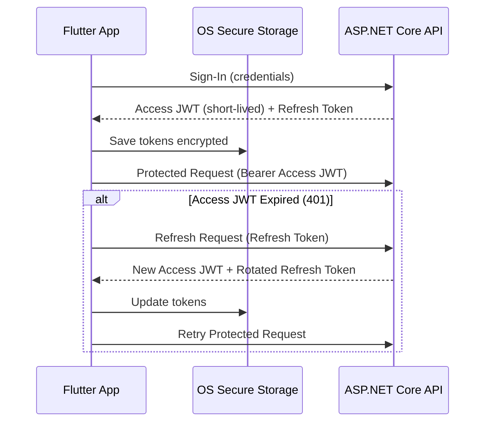

# EduScroll — Client-Backend Integration Design

- **Document Version:** 0.1
- **Status:** Draft — Pending Product Owner Review & Approval
- **Work Package:** WP-05 (Flutter–Backend Integration)
- **Last Updated:** 2026-11-17

> **Rule Compliance:** Per WP-05 instructions, final API route paths and concrete DTO field contracts are **NOT** invented here and will be finalized once `FR-*`, `TBD-005`, `TBD-014`, `TBD-017`, and `ADR-001`/`ADR-004` are approved.

---

## 1. API Communication Principles
1. **Protocol (**CONFIRMED**):** RESTful JSON over HTTPS/TLS (`SEC-004`).
2. **Stateless Server Authentication (**CONFIRMED**):** JWT Bearer token in `Authorization: Bearer <token>` header (`SEC-001`).
3. **Client Secret Zero-Trust (**CONFIRMED** — Constraint #11):** Flutter holds user session tokens only; never YouTube API keys or LLM credentials.
4. **Correlation:** Backend generates/propagates a `Correlation-Id` / `TraceId` header on every response for diagnostics (`NFR-008`).

---

## 2. Authentication Flow (**PROPOSED — `DEC-P10`**)

- Unresolved parameters: `TBD-008` (email verification & password reset), `TBD-009` (JWT & refresh token lifetimes, concurrent sessions).

---

## 3. Request and Response Conventions (**PROPOSED**)
- **Content Type:** `application/json; charset=utf-8` across all MVP endpoints (note: PDF text extraction happens locally on Flutter per `BR-003`, so even PDF submission transmits JSON containing extracted text + metadata rather than multipart PDF binary upload).
- **Timestamps:** ISO 8601 UTC (`YYYY-MM-DDTHH:mm:ssZ`).
- **Identifiers:** Server-generated opaque IDs (UUID/Guid) for resources (`SourceId`, etc.)—avoid sequential integer IDs to reduce enumeration predictability alongside mandatory `SEC-003` ownership checks.

---

## 4. Error Response Conventions (**PROPOSED — `DEC-P07`**)
Standardize all `4xx`/`5xx` error responses on **RFC 9457 `ProblemDetails`** (`application/problem+json`) containing:
- `type`, `title`, `status`, `detail` (user-safe message, zero stack traces/internal IPs)
- `code` (stable machine-readable error code, e.g., `SSRF_BLOCKED`, `AI_SCHEMA_INVALID`, `QUOTA_EXCEEDED`)
- `traceId` (for support/log correlation)
- `errors` dictionary (for field-level validation failures)

---

## 5. Processing Status Communication (**PROPOSED — `ADR-004` / `DEC-P04`**)
Because AI analysis + YouTube discovery can take multiple seconds (especially under local Ollama inference):
1. Source submission returns `202 Accepted` with `SourceId` and initial state (`Pending`).
2. Flutter polls the source status endpoint at a bounded/backoff interval while the source detail/progress view is active.
3. Response includes explicit `status` (`Pending`, `AcquiringContent`, `Analyzing`, `DiscoveringVideos`, `Ranking`, `Completed`, `PartiallyCompleted`, `Failed`), timestamps, and sanitized `failureCode` if failed.
- *Rationale:* Polling avoids WebSocket/SignalR connection-state complexity on mobile networks in MVP (Constraint #15); push notifications/SSE can be added post-MVP without breaking REST resources.

---

## 6. Pagination Requirements (**PROPOSED**)
- **Feed & Source List Endpoints:** Must be paginated with bounded `pageSize` (min/max enforced server-side, `TBD`).
- **Strategy:** Cursor-based pagination (or stable keyset/rank-ordered page token) is recommended for the vertical video feed to prevent duplicate/skipped items if feed data refreshes, while offset/page-number pagination is acceptable for the user's smaller Source Library.

---

## 7. Data Ownership Enforcement (**CONFIRMED** — Constraint #12)
- User identity (`UserId`) is extracted exclusively from the validated JWT `sub` claim—never trusted from request bodies, query strings, or headers.
- Every query against `Source`, `SourceAnalysis`, `SourceVideoRecommendation`, and conditional `Bookmark`/`ViewingHistory` includes a mandatory `OwnerUserId == CurrentUserId` predicate (`SEC-003`).

---

## 8. API Versioning Considerations (**PROPOSED — `DEC-P08`**)
- Recommend URL path versioning (`/api/v1/...`) from Sprint 1 so breaking contract evolutions (e.g., future multi-source feed or V2 ranking metadata) can be introduced cleanly without breaking older mobile app binaries installed on users' phones.
