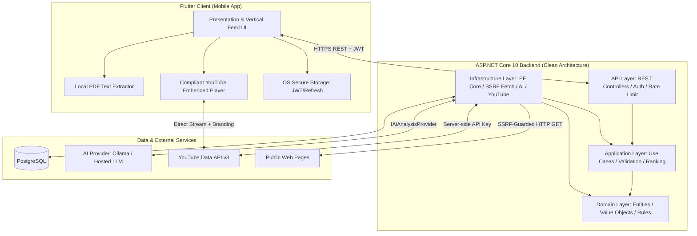

# EduScroll — System Overview & Technology Evaluation

- **Document Version:** 0.1
- **Status:** Draft — Pending Product Owner Review & Approval
- **Work Package:** WP-05 & Section 2 Technical Direction Analysis
- **Last Updated:** 2026-11-17

---

## 1. Conceptual System Architecture

---

## 2. Evaluation of Intended Technical Direction (Brief §2)

Every technology listed below is **CONFIRMED** as the intended direction unless noted otherwise. Unselected sub-libraries (e.g., specific PDF package, HTTP client, or background queue library) are intentionally **not** assumed.

| Area | Intended Tech | Responsibility | Integration Requirements | Key Risks | Unresolved Decisions | Alternatives (Only If Justified) |
|---|---|---|---|---|---|---|
| **Backend** | ASP.NET Core 10 Web API | Expose REST endpoints, JWT auth, rate limiting, and host/dispatch Application use cases. | `net10.0` (verified in `src/`), HTTPS/TLS, middleware pipeline. | Existing `src/EduScroll.Web` uses MVC Razor Views (`CONF-001`), adding unused HTML/jQuery surface. | `ADR-001` (`TBD-001`): refactor `EduScroll.Web` to pure API vs. `EduScroll.Api`. | None needed; ASP.NET Core 10 Web API fits well. |
| **Backend Architecture** | Clean Architecture | Separate `Domain`, `Application`, `Infrastructure`, and `API` to protect business rules and testability. | Strict project dependency graph (`Domain` <- `Application` <- `Infrastructure`/`API`). | Over-abstraction in small MVP (Constraint #15); existing `IPdfTextExtractor` conflicts with local extraction (`CONF-002`). | `ADR-002` (`TBD-002`): resolve `IPdfTextExtractor`; background worker hosting (`ADR-004`). | Vertical Slice inside Clean Architecture Application layer (optional structural style, same layer boundaries). |
| **Frontend** | Flutter | Cross-platform UI, local PDF text extraction, vertical short-video feed, compliant YouTube playback, secure token storage. | Dart/Flutter SDK, OS file picker, OS secure storage, YouTube WebView/IFrame embed plugin, PDF text library. | Platform-specific WebView/YouTube embed quirks; PDF extraction memory/UI-jank on large files; no Flutter project exists yet. | `TBD-003` (platforms), `TBD-022` (state management `ADR-005`, PDF & player packages after Sprint 3 spike). | None justified; Flutter meets single-codebase mobile need. |
| **Database** | PostgreSQL | Durable relational storage for Identity users, sources, analyses, topics, queries, video metadata, and rankings. | Connection pooling, migrations, JSONB/indexed relational schema (`WP-08`). | Long text storage growth (`CleanedText`) if unbounded (`TBD-005`, `TBD-019`); backup/RPO undefined (`TBD-011`). | `TBD-019` (retention), `TBD-023` (per-user vs shared video/analysis cache). | None needed; PostgreSQL handles relational + text/JSON well. |
| **ORM** | Entity Framework Core | Schema migrations, LINQ queries, unit-of-work persistence in `Infrastructure`. | Npgsql EF Core provider, ASP.NET Core Identity EF stores. | N+1 queries or tracking overhead on feed reads; leaking EF entities into `Domain`/`Application` if misused. | Mapping strategy (separate Infrastructure persistence models vs Domain entities with fluent configs). | Dapper only for hot read queries if profiling proves EF bottleneck (not needed in MVP). |
| **Authentication** | ASP.NET Core Identity + JWT | User registration, salted password hashing, JWT Bearer issuance/validation. | Identity tables in PostgreSQL, signing key secret management (`SEC-008`), refresh token storage (`DEC-P10`). | Token theft if stored insecurely on client (`SEC-005`); long-lived JWT without revocation; `TBD-008` email verification undefined. | `TBD-008` (verification/reset), `TBD-009` (JWT/refresh TTL), `DEC-P10`. | External OIDC provider (e.g., Auth0) only if social login/SSO is requested later (not in MVP). |
| **AI Integration** | Provider Abstraction | Isolate Application use cases from LLM vendor APIs, prompts, and transport details (`Constraint #7`). | Clean Application interface(s), structured JSON output & schema validation (`WP-06`). | Leaky abstractions (model-specific prompt or JSON quirks leaking into Application); inconsistent schema compliance across models. | Context-window chunking (`TBD-013`), prompt versioning & eval set (`WP-06`). | None; abstraction is a Non-Negotiable Constraint (#7). |
| **Initial Local AI Provider** | Ollama | Local/dev inference for topic extraction, summarization, and query generation without per-token cloud cost. | HTTP client to Ollama base URL (`appsettings.json` observed, `CONF-003`), model selection (`YOUR_MODEL_NAME`). | **Critical:** Local CPU/GPU latency, concurrency limits, structured-JSON reliability of small models, and unsuitable scaling on standard PaaS without GPU (`ADR-003`). | `TBD-012` (exact model name & production hosting vs hosted API), `TBD-004` (language support). | **PROPOSED (`ADR-003`):** Keep Ollama for local dev/self-hosted GPU, evaluate managed LLM API for Sprint 12 production if GPU hosting is unavailable. |
| **Video Discovery** | YouTube Data API | Server-side search and metadata enrichment (`embeddable`, duration, channel, stats). | Google Cloud API key on backend (`SEC-008`), quota monitoring, ToS compliance. | Strict daily quota limits (especially `search.list` calls) and ToS restrictions on metadata caching/storage (`TBD-015`). | `TBD-014` (queries/feed size), `TBD-015` (quota & cache TTL), `TBD-016` (duration/filter rules). | None; YouTube Data API is the confirmed video discovery source. |
| **Communication** | REST API | Versioned JSON over HTTPS between Flutter and backend. | OpenAPI spec (recommended), `ProblemDetails` errors (`DEC-P07`), pagination (`WP-05`). | Blocking HTTP requests if long AI/YouTube pipeline runs synchronously (`ADR-004`). | `DEC-P04`/`ADR-004` (polling vs SSE/WS), `DEC-P08` (`/api/v1` versioning). | GraphQL/gRPC unnecessary for focused MVP (Constraint #15). |
| **Deployment** | Production-oriented CI/CD | Automated build, tests, secret scan, migrations, container/app deploy. | Hosting target (`TBD-011`), PostgreSQL managed service or container, secret vault, CI runner. | Undefined target cloud/host (`TBD-011`) and GPU requirement if Ollama runs in prod (`ADR-003`). | `TBD-011` (hosting provider, uptime SLA, backup RPO/RTO). | Hosting platform options evaluated prior to Sprint 12. |
