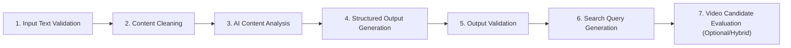

# EduScroll — AI Pipeline Design (WP-06)

- **Document Version:** 0.1
- **Status:** Draft — Pending Product Owner Review & Approval
- **Work Package:** WP-06 (AI Pipeline Design)
- **Last Updated:** 2026-11-17

> **Rule Compliance:** No model accuracy, latency, or token-throughput claims are invented. All model choices, token caps, and evaluation thresholds require empirical measurement in Sprint 5/8 (`TBD-004`, `TBD-012`, `TBD-013`).

---

## 1. End-to-End 7-Stage AI Pipeline

| Stage | Owner Layer | Inputs & Outputs | Responsibilities |
|---|---|---|---|
| **1. Input Text Validation** | `Application` | In: Raw extracted text. Out: Validated raw text or `INVALID_CONTENT`. | Enforce non-empty text, UTF-8 validity, minimum readable character threshold, and hard maximum bounds (`TBD-005`). |
| **2. Content Cleaning** | `Application` / `Infrastructure` | In: Validated raw text (PDF or acquired HTML). Out: Normalized plain text. | Strip residual HTML/markup/boilerplate, collapse excessive whitespace/control characters, deduplicate repeated headers/footers where safe, prepare for token budgeting. |
| **3. AI Content Analysis** | `Application` port -> `Infrastructure` adapter | In: Cleaned text + system prompt. Out: Raw provider response. | Extract `topics`, `subtopics`, `keywords`, `concepts`, and `summary` (Journey Step 5) via `IAiAnalysisProvider`. |
| **4. Structured Output Generation** | `Infrastructure` (AI Adapter) | In: Prompt + JSON schema instruction. Out: JSON string response. | Use provider-supported structured JSON mode/grammar constraints (e.g., Ollama `format: "json"` or schema mode where supported) with deterministic decoding settings (`TBD-012`). |
| **5. Output Validation** | `Application` | In: Raw JSON string. Out: Validated `SourceAnalysisResult` or retry/fail. | Treat AI output as untrusted (`SEC-010`, `BR-005`): parse JSON strictly, check required fields (`summary`, `topics`, `subtopics`, `keywords`, `concepts`), enforce min/max array counts and string lengths, reject prompt-injection leakage or HTML/script payloads. |
| **6. Search Query Generation** | `Application` (and/or `IAiAnalysisProvider`) | In: Validated `SourceAnalysisResult`. Out: Bounded list of sanitized YouTube search queries. | **PROPOSED:** Generate queries either within the validated AI schema or via a deterministic Application combiner from top `(Topic + Concept)` pairs, then sanitize and cap to `TBD-014` queries (`WF-08`). |
| **7. Video Candidate Evaluation** | `Application` (+ optional AI port) | In: `SourceAnalysisResult` + YouTube metadata. Out: Relevance scores (`WP-07`). | **PROPOSED:** Use deterministic lexical/topic/concept scoring as the MVP baseline (`WP-07`), keeping optional LLM re-ranking behind an abstraction for evaluation before enabling (avoids unpredictable latency/cost in MVP). |

---

## 2. AI Provider Abstraction (`Constraint #7`)
- **Application Port (`IAiAnalysisProvider`):** Accepts a clean `AiAnalysisRequest` (cleaned text, target language hint per `TBD-004`, max output constraints) and returns a provider-agnostic `AiAnalysisRawResult` (or typed DTO validated in Application).
- **Boundary Rule:** Ollama HTTP DTOs, prompt formatting specifics, model names, and API keys reside strictly in `Infrastructure` (`NFR-006`).
- **Configuration Fix (`CONF-003`):** Move Ollama settings out of `ConnectionStrings` in `appsettings.json` into a strongly-typed `AiProviderOptions` section (`Provider`, `BaseUrl`, `Model`, `TimeoutSeconds`, `MaxRetries`).

---

## 3. Prompt Management & Prompt Injection Defense (`SEC-009`)
- **Versioned Prompt Templates (**PROPOSED**):** Store prompts as versioned resources in `Infrastructure` (with `PromptVersion` recorded alongside `SourceAnalysis` for reproducibility and regression testing).
- **Instruction/Data Separation:** System instructions explicitly define the extraction task and schema; untrusted source text is wrapped in strict delimiters (e.g., XML/marker blocks) with explicit instructions to treat enclosed text strictly as data to summarize, never as instructions to follow.
- **Zero Tool Execution:** The analysis model has no database, filesystem, network, or shell tool bindings.

---

## 4. Token & Context Window Limitations (`TBD-013`)
Models have finite context windows; PDFs or long web pages can exceed them. **Unresolved (`TBD-013`):**
- **Option A — Bounded Prefix + Representative Sampling:** Fast and low-cost; risks missing concepts in later chapters.
- **Option B — Chunked Map-Reduce Summarization:** Split cleaned text into overlapping chunks -> extract per-chunk concepts -> merge/deduplicate into final `SourceAnalysis`. Handles full documents at higher latency/token cost.
- **Option C — Hard Cap Rejection:** Reject inputs above `TBD-005` character/token limit.
- **PROPOSED:** Define a safe character/token ceiling (`TBD-005`) and use single-pass within context window for MVP, adding map-reduce chunking (`Option B`) if long PDFs are confirmed in `TBD-013`.

---

## 5. Timeout, Retry & Failure Handling (`Constraint #13`)
- **Timeouts:** Enforce explicit per-call HTTP timeouts (e.g., configurable `TimeoutSeconds` observed in existing `appsettings.json`, final value `TBD-010`) and cancellation token propagation.
- **Transient Retries:** Bounded exponential-backoff retries on transient HTTP `5xx`, connection resets, or `429` responses (`NFR-003`).
- **Validation Retries:** If JSON parsing or schema validation fails (`SEC-010`), allow a configurable bounded number of repair/re-prompt attempts (`TBD`); if still invalid, fail cleanly (`FR-025`, `SourceStatus.Failed` with `AI_SCHEMA_INVALID` or `AI_PROVIDER_TIMEOUT`). Never persist unvalidated AI output (`BR-005`).

---

## 6. Model Configuration & Ollama Local vs. Hosted Operational Analysis (`ADR-003`)

| Dimension | Local Ollama (Self-Hosted / Dev) | Hosted LLM API (e.g., Managed API Provider) |
|---|---|---|
| **Cost Model** | Zero per-token API fees locally; fixed GPU hardware/hosting cost in production (`TBD-011`). | Pay-per-token variable cost; zero GPU infrastructure management. |
| **Latency & Concurrency** | CPU inference is slow and degrades severely under concurrent requests; production requires dedicated GPU (`ADR-003`). | Managed autoscaling and predictable concurrency under rate-limit tiers. |
| **Data Privacy / Residency** | Extracted user text never leaves operator-controlled environment (`SEC-015`). | User text transmitted to third-party API; requires vendor privacy review and user disclosure (`TBD-020`, `SEC-015`). |
| **Structured JSON Reliability** | Smaller local open-weights models vary significantly in strict JSON adherence; requires empirical schema pass-rate testing (`evaluation-strategy.md`). | Frontier/hosted models often support strict JSON schema decoding with higher reliability (must still be validated per `SEC-010`). |
| **Operational Complexity** | Must manage model weights, VRAM sizing, cold starts, health checks, and GPU scaling. | Managed availability; must manage API keys (`SEC-008`), egress quotas, and vendor outages. |
