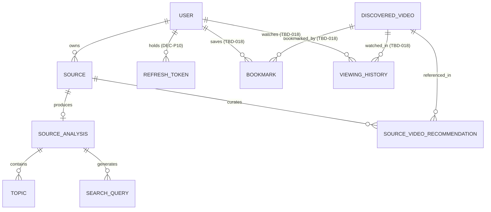

# EduScroll — Conceptual Data Model (WP-08)

- **Document Version:** 0.1
- **Status:** Draft — CANDIDATE CONCEPTS Pending Product Owner Approval
- **Work Package:** WP-08 (Data Model Planning)
- **Last Updated:** 2026-11-17

> **Scope Boundary:** All entities below are **PROPOSED conceptual candidates**, **not** approved database tables or EF Core models. No EF Core classes or migrations are generated in Sprint 0. Conditional concepts (`Bookmark`, `ViewingHistory`) depend on `TBD-018`; `RefreshToken` depends on `DEC-P10`.

---

## 1. Conceptual Entity-Relationship Diagram

---

## 2. Candidate Entities Analysis

| Entity (Candidate) | Status | Purpose | Owner | Relationships | Lifecycle | Data Sensitivity | Retention Considerations |
|---|---|---|---|---|---|---|---|
| **User** | **CONFIRMED** (Identity) | Represents an authenticated learner account (Identity credentials, unique email/username). | System / User | `1:N` with `Source`, `RefreshToken`, and conditional `Bookmark`/`ViewingHistory`. | Created on registration (`FR-001`); updated on profile/password change; deactivated/purged on account deletion (`SEC-014`). | **High (PII + Password Hash)** — hashed via Identity (`SEC-002`); never logged (`SEC-012`). | Retained while account is active; purge SLA upon account deletion is `TBD-019` (`TBD-020`). |
| **RefreshToken** | **PROPOSED** (`DEC-P10`) | Supports revocable JWT refresh rotation (`FR-003`, `FR-004`). | User (managed by Auth Infra) | `N:1` to `User`. | Created at sign-in; rotated/revoked on refresh or sign-out; expires after `TBD-009`. | **High (Credential Secret)** — store cryptographic hash, never plaintext token. | Auto-purge expired/revoked tokens after short grace window (`TBD-019`). |
| **Source** | **CONFIRMED** | Represents a user's submitted PDF text or web URL, its processing state (`Pending`–`Completed`/`Failed`), and error code. | **User** (`OwnerUserId`) | `N:1` to `User`; `1:0..1` to `SourceAnalysis`; `1:N` to `SourceVideoRecommendation`. | Created on submission (`WF-02`/`WF-04`); transitions through processing states (`SRS §15`); deleted by user (`FR-023`) or account deletion. | **Medium–High (User Content)** — extracted document text may contain private study notes or sensitive text; never log raw text (`SEC-012`). | Retention period for raw/cleaned `ExtractedText` vs. metadata-only is `TBD-019` (note: keeping text enables `FR-026` retry and `TBD-024` revisit). |
| **SourceAnalysis** | **CONFIRMED** | Stores validated AI output: `Summary`, `Keywords`, `Concepts`, `PromptVersion`, and model metadata (`FR-012`, `FR-015`). | **User** (via `Source`) | `1:1` with `Source`; `1:N` with `Topic` and `SearchQuery`. | Created only after passing AI schema validation (`BR-005`); replaced on re-analysis/retry (`FR-026`); cascade-deleted with `Source`. | **Medium (Derived User Content)** — derived from user's source; isolated via `Source` ownership (`SEC-003`). | Tied directly to `Source` lifecycle (`TBD-019`). |
| **Topic** | **CONFIRMED** | Normalizes extracted educational topics and subtopics (parent/child or hierarchy tag) for display and ranking (`FR-012`). | **User** (via `SourceAnalysis`) | `N:1` to `SourceAnalysis` (optional self-ref `ParentTopicId` for subtopics). | Created alongside `SourceAnalysis`; cascade-deleted with `SourceAnalysis`. | **Low–Medium** — derived topical labels scoped to `Source`. | Tied to `SourceAnalysis` lifecycle. |
| **SearchQuery** | **CONFIRMED** | Records sanitized search strings generated from `SourceAnalysis` and YouTube execution status/timestamp (`FR-014`). | **User** (via `SourceAnalysis`) | `N:1` to `SourceAnalysis`. | Created in `WF-08`; updated with discovery outcome in `WF-09`; cascade-deleted with `SourceAnalysis`. | **Low** — search phrases derived from topics/concepts. | Tied to `SourceAnalysis` lifecycle; useful for audit/debugging quota usage. |
| **DiscoveredVideo** | **CONFIRMED** | Stores YouTube video identifier (`YouTubeVideoId`) and metadata ONLY (`Title`, `ChannelTitle`, `Description`, `Duration`, `ThumbnailUrl`, `IsEmbeddable`, `MetadataFetchedAt`). **Never** stores video media files (`BR-001`). | **System Catalog** (shared metadata reference, subject to `TBD-015` & `TBD-023`) | `1:N` to `SourceVideoRecommendation` (and conditional `Bookmark`/`ViewingHistory`). | Upserted during `WF-11`; refreshed or expired per YouTube ToS caching TTL (`TBD-015`); pruned when unreferenced/expired. | **Low (Public YouTube Metadata)** — subject to YouTube API Services ToS caching/deletion constraints (`TBD-015`). | **CRITICAL (`TBD-015`):** Must respect YouTube API ToS maximum metadata caching/storage lifetime; periodic staleness refresh or purge required. |
| **SourceVideoRecommendation** *(Source-Video Relationship)* | **CONFIRMED** | Associates a `Source` with ranked `DiscoveredVideo` candidates (`RelevanceScore`, `RankOrder`, `MatchedSignals`/`Topics`, `CreatedAt`). | **User** (via `Source`) | `N:1` to `Source`; `N:1` to `DiscoveredVideo`. | Created/replaced in `WF-11`; read in `WF-12`; cascade-deleted with `Source`. | **Medium (User Learning Context)** — reveals what videos align with a user's private study source; protected by `SEC-003`. | Tied to `Source` lifecycle (`TBD-019`). |
| **Bookmark** | **PROPOSED (Should Have — `TBD-018`)** | Persists user-saved videos (`UserId`, `DiscoveredVideoId`, optional `SourceId`, `CreatedAt`). | **User** | `N:1` to `User`; `N:1` to `DiscoveredVideo`. | Created/deleted by user action (`FR-027`); cascade-deleted on account deletion. | **Medium (User Behavior)** — personal study preferences. | Deleted on user unbookmark or account deletion (`TBD-019`). |
| **ViewingHistory** | **PROPOSED (Should Have — `TBD-018`)** | Records user video watch events (`UserId`, `DiscoveredVideoId`, `SourceId`, `WatchedAt`) to avoid repetition/support resume (`FR-028`). | **User** | `N:1` to `User`; `N:1` to `DiscoveredVideo`. | Appended during playback (`WF-13`); deletable by user or account deletion. | **Medium–High (Behavioral History)** — tracks viewing habits. | Requires explicit retention limit & clear-history option (`TBD-019`, `TBD-020`). |

---

## 3. Open Data Architecture Questions
1. **`TBD-023` (Metadata Sharing vs. Strict Per-User Isolation):** `DiscoveredVideo` holds public YouTube metadata keyed by `YouTubeVideoId` to avoid duplicating public fields across feeds. Confirm whether cross-user reuse of cached `DiscoveredVideo` metadata (within `TBD-015` ToS TTL) is approved, while keeping `Source`, `SourceAnalysis`, `SearchQuery`, and `SourceVideoRecommendation` strictly user-isolated (`BR-006`).
2. **`TBD-019` (Text Storage Minimization):** Confirm whether `Source.CleanedText` is retained indefinitely (enabling retry `FR-026` and source preview `TBD-024`) or purged after analysis completes.
