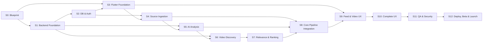

# EduScroll — Dependency-Aware Sprint Roadmap (WP-11)

- **Document Version:** 0.1
- **Status:** Draft — Pending Product Owner Review & Approval
- **Work Package:** WP-11 (Sprint Roadmap)
- **Last Updated:** 2026-11-17

---

## 1. Dependency Graph & Sequencing Analysis

### Recommended Sequencing Adjustments (**PROPOSED — Requires Approval**)
1. **Sprint 3 (Flutter Foundation) vs. Sprint 2 (Auth):** Keep Sprint 3 dependent on Sprint 2 API auth contract alignment (or start Sprint 3 UI/spike work in parallel using OpenAPI contract mocks once `ADR-005` & `TBD-003` are approved).
2. **Sprint 4 (Source Ingestion) Split Across Client & Backend:** Because Constraint #3 puts PDF extraction in Flutter and Constraint #5 puts URL acquisition on the backend, Sprint 4 requires **both** Sprint 2 (authenticated endpoints/DB) and Sprint 3 (Flutter foundation/PDF spike) to deliver end-to-end ingestion.
3. **Production AI Hosting Decision (`ADR-003` / `TBD-012`) Gate at Sprint 8:** Confirm production LLM hosting (dedicated GPU Ollama vs. managed API) by Sprint 8 exit so Sprint 11–12 performance/security testing reflects real production topology.

---

## 2. Sprint-by-Sprint Plan (Sprint 0 – Sprint 12)

### Sprint 0 — Product Definition and Engineering Blueprint
- **Objective:** Complete discovery, requirements engineering, architecture planning, threat analysis, and roadmap without writing application code.
- **Scope:** WP-01 through WP-11 documentation in `docs/`, repository conflict audit (`CONF-001`–`CONF-004`).
- **Dependencies:** Product brief; repository inspection.
- **Expected Deliverables:** Complete `docs/` suite (`PROJECT-DECISIONS.md`, SRS, workflows, architecture + ADRs, AI/discovery/ranking specs, conceptual data model, threat analysis, testing strategy, sprint roadmap).
- **Acceptance Criteria:** All Definition of Done items in Sprint 0 verified; zero application code written; Product Owner review completed.
- **Main Risks:** Unresolved `TBD-001`–`TBD-024` delaying Sprint 1/3 starts.
- **Out-of-Scope:** Any C#/Dart source code, EF migrations, Flutter project creation.

### Sprint 1 — Backend Foundation
- **Objective:** Establish clean ASP.NET Core 10 Web API foundation, CI pipeline, and architecture guardrails.
- **Scope:** Resolve `CONF-001` (`ADR-001`), `CONF-002` (`ADR-002`), and `CONF-003`; configure `ProblemDetails`, correlation logging, `/api/v1` convention (`DEC-P08`), health check, test projects in `test/`, architecture tests (`NFR-005`), and CI secret scanning.
- **Dependencies:** Sprint 0 approval (`TBD-001`, `TBD-002`, `DEC-P07`, `DEC-P08`).
- **Expected Deliverables:** Clean compilable Web API solution, test projects, architecture tests, CI build/test workflow.
- **Acceptance Criteria:** Architecture tests pass; health check & `ProblemDetails` middleware verified; zero secrets in repo.
- **Main Risks:** Delay in approving `ADR-001`/`ADR-002`.
- **Out-of-Scope:** Business features, EF Core domain tables, AI/YouTube calls.

### Sprint 2 — Database and Authentication
- **Objective:** Implement PostgreSQL persistence foundation, ASP.NET Core Identity, JWT/refresh auth, and rate limiting.
- **Scope:** EF Core + Npgsql setup, Identity + `User` + `RefreshToken` (`DEC-P10`) migrations, register/login/refresh/logout endpoints (`FR-001`–`FR-004`), JWT middleware (`SEC-001`), rate limiting (`SEC-011`).
- **Dependencies:** Sprint 1; `TBD-008`, `TBD-009`, `TBD-021`.
- **Expected Deliverables:** Initial DB migrations, auth endpoints, API integration & security tests (`401`, `429`).
- **Acceptance Criteria:** Auth flows pass integration tests; passwords hashed via Identity (`SEC-002`); secret config externalized (`SEC-008`).
- **Main Risks:** Unresolved email verification/reset (`TBD-008`) or token TTL (`TBD-009`) rules.
- **Out-of-Scope:** Password reset UI/email provider unless `TBD-008` requires it in MVP; source entities.

### Sprint 3 — Flutter Foundation
- **Objective:** Bootstrap maintainable Flutter app with approved state management, secure storage, navigation, and auth UI.
- **Scope:** Create Flutter project, integrate approved state management (`ADR-005`) and API client with JWT refresh interceptor, OS secure storage (`SEC-005`), Sign-In/Register screens, plus technical spikes for local PDF extraction and YouTube IFrame embedding (`TBD-022`, `ADR-006`).
- **Dependencies:** Sprint 0, Sprint 2 auth contract; `TBD-003`, `TBD-022`.
- **Expected Deliverables:** Working Flutter app connecting to Sprint 2 auth API; documented spike results for PDF & YouTube plugins.
- **Acceptance Criteria:** Auth round-trip works on target platforms (`TBD-003`); tokens verified in secure storage; widget tests pass in CI.
- **Main Risks:** Platform-specific WebView/YouTube embed or PDF library incompatibilities (`ASM-002`).
- **Out-of-Scope:** Source submission UI, AI/feed screens.

### Sprint 4 — Source Ingestion and Content Extraction
- **Objective:** Implement end-to-end PDF local text extraction, SSRF-hardened web URL acquisition, cleaning, and `Source` persistence.
- **Scope:** `Source` entity & ownership rules (`SEC-003`), Flutter local PDF picker/extractor (`FR-005`, `FR-006`), URL submission (`FR-007`), SSRF-safe `IWebContentFetcher` (`FR-008`, `SEC-006`), text cleaning/validation (`FR-009`), source list/status endpoints (`FR-024`).
- **Dependencies:** Sprint 2, Sprint 3; `TBD-005`, `TBD-006`, `TBD-007`.
- **Expected Deliverables:** PDF & URL ingestion endpoints, SSRF test suite, Flutter submission screens.
- **Acceptance Criteria:** Local PDF sends text only (no binary, `BR-003`); SSRF suite blocks loopback/RFC1918/metadata/redirects; ownership isolation (`SEC-003`) passes IDOR tests.
- **Main Risks:** Scanned PDFs (`TBD-006`), JS-heavy SPAs (`TBD-007`), DNS-rebinding edge cases.
- **Out-of-Scope:** AI analysis and YouTube discovery.

### Sprint 5 — AI Content Analysis
- **Objective:** Build provider-abstracted AI content analysis, strict output schema validation, query generation, and evaluation harness.
- **Scope:** `IAiAnalysisProvider` (`FR-011`), Ollama adapter (`CONF-003` resolved), prompt templates with injection delimiters (`SEC-009`), `OutputValidator` (`FR-013`, `SEC-010`), `SourceAnalysis`/`Topic`/`SearchQuery` persistence (`FR-012`, `FR-014`, `FR-015`), golden evaluation runner.
- **Dependencies:** Sprint 1, Sprint 4 (`CleanedText`); `TBD-004`, `TBD-012`, `TBD-013`.
- **Expected Deliverables:** Validated AI analysis & query generator modules, prompt-injection & schema unit tests, Sprint 5 AI eval report.
- **Acceptance Criteria:** Provider swap works without touching Application/Domain (`NFR-006`); invalid JSON/injection fixtures rejected (`BR-005`).
- **Main Risks:** Small local Ollama models failing JSON schema compliance or slow CPU inference (`ADR-003`).
- **Out-of-Scope:** YouTube API calls, ranking, UI feed.

### Sprint 6 — Video Discovery Engine
- **Objective:** Implement server-side YouTube Data API search, deduplication, embeddability filtering, and metadata-only persistence.
- **Scope:** `IVideoDiscoveryService` (`FR-016`), `search.list` + `videos.list` batching, deduplication (`FR-017`), `embeddable`/`public`/duration filtering (`BR-002`, `TBD-016`), `DiscoveredVideo` metadata-only persistence (`FR-019`, `BR-001`), quota/retry handling (`NFR-003`).
- **Dependencies:** Sprint 1, Sprint 5 (`SearchQuery`); `TBD-014`, `TBD-015`, `TBD-016`, `TBD-023`.
- **Expected Deliverables:** YouTube discovery service, metadata repository, mock HTTP & quota fault-injection tests.
- **Acceptance Criteria:** Zero video media files stored; non-embeddable videos excluded; API key strictly backend-only (`SEC-008`).
- **Main Risks:** YouTube daily quota exhaustion during dev/testing (`TBD-015`).
- **Out-of-Scope:** Relevance scoring/ranking tuning, Flutter playback UI.

### Sprint 7 — Relevance and Ranking Engine
- **Objective:** Implement deterministic multi-signal relevance ranking and validate against a labeled relevance dataset.
- **Scope:** Candidate scoring engine (`WP-07`: topic, concept, title, description, query signals), `SourceVideoRecommendation` ordering (`FR-018`), labeled benchmark evaluation (`WP-10`).
- **Dependencies:** Sprint 6; `TBD-014`, `TBD-016`.
- **Expected Deliverables:** Ranking engine in `Application`, comprehensive unit tests (including missing metadata), benchmark evaluation metrics.
- **Acceptance Criteria:** Deterministic ranking order verified; benchmark dataset metrics recorded without unverified claims.
- **Main Risks:** Insufficient metadata descriptions on short videos degrading lexical matching.
- **Out-of-Scope:** ML-trained rankers or user feedback loops (`FEAT-018`).

### Sprint 8 — Core Pipeline Integration
- **Objective:** Connect ingestion -> AI -> discovery -> ranking in a resilient async pipeline with full status tracking and recovery.
- **Scope:** Background worker orchestration (`ADR-004`), state transitions (`Pending` -> `Completed`/`PartiallyCompleted`/`Failed`), bounded retries & retry endpoint (`FR-024`, `FR-025`, `FR-026`, `WF-15`), atomic metadata commits (`WF-11`), structured correlation logging (`NFR-008`, `SEC-012`).
- **Dependencies:** Sprints 4, 5, 6, 7; `TBD-010`, `TBD-012` (prod AI decision gate).
- **Expected Deliverables:** End-to-end backend pipeline, paginated feed & source detail API endpoints (`FR-020`, `FR-022`), full pipeline integration & IDOR tests.
- **Acceptance Criteria:** Full PDF-text/URL -> ranked feed works end-to-end; fault injection recovers cleanly without corrupt partial data.
- **Main Risks:** Long end-to-end latency under local Ollama; DB transaction/lock contention.
- **Out-of-Scope:** Conditional Sprint 10 UX polish.

### Sprint 9 — Educational Feed and Video Experience
- **Objective:** Deliver the vertical short-video discovery feed, compliant YouTube playback, and source revisit flow in Flutter.
- **Scope:** Status polling UI, vertical `PageView` feed (`FR-020`, `FR-021`), compliant YouTube IFrame embedded player (`ADR-006`, `BR-002`), single-active-player lifecycle management, "View Source" summary/topic/URL navigation (`FR-022`, `TBD-024`), unplayable-video fallback (`WF-13`).
- **Dependencies:** Sprint 3, Sprint 8; `TBD-017`, `TBD-024`.
- **Expected Deliverables:** Working mobile feed + playback + source revisit screens; Flutter widget & E2E smoke tests.
- **Acceptance Criteria:** Vertical feed scrolls smoothly without audio/controller leaks; YouTube branding/controls preserved; users can revisit source analysis from any video.
- **Main Risks:** WebView memory leaks or Android/iOS autoplay/fullscreen quirks (`ADR-006`).
- **Out-of-Scope:** Bookmarks, viewing history, source deletion polish (unless prioritized).

### Sprint 10 — Complete User Experience
- **Objective:** Complete source library management, error-recovery UX, and any Product Owner-approved Should-Have features.
- **Scope:** Source library list & deletion (`FR-022`, `FR-023`), retry failed source UI (`FR-026`), UX polish/empty states; **conditional on `TBD-018`/`TBD-008`:** Bookmarks (`FR-027`), Viewing History (`FR-028`), Password Reset (`FR-029`).
- **Dependencies:** Sprint 9; `TBD-018`, `TBD-019`, `TBD-008`.
- **Expected Deliverables:** Complete MVP user journeys in Flutter + supporting API endpoints/tests.
- **Acceptance Criteria:** Source deletion purges user-owned data cleanly (`SEC-014`); all Must-Have requirements (`FR-001`–`FR-026`) demonstrable end-to-end.
- **Main Risks:** Scope creep from unapproved Should/Could-Have items.
- **Out-of-Scope:** Any Could-Have or Out-of-Scope items (`product-scope.md`).

### Sprint 11 — Quality Assurance and Security
- **Objective:** Execute comprehensive security, privacy, YouTube policy, performance, and regression verification prior to release.
- **Scope:** Full E2E regression, STRIDE threat verification (`THR-001`–`THR-013`), SSRF & IDOR & prompt-injection testing, Flutter release artifact secret inspection, log hygiene audit (`SEC-012`), YouTube API ToS compliance checklist, load/performance testing against `TBD-010`.
- **Dependencies:** Sprint 10; `TBD-010`, `TBD-019`, `TBD-020`.
- **Expected Deliverables:** QA sign-off report, security verification report, resolved defect log, privacy policy/notice text (`SEC-015`).
- **Acceptance Criteria:** Zero open critical/high security defects; all `SEC-*` and `NFR-*` gates verified against approved targets.
- **Main Risks:** Discovering performance bottlenecks (`TBD-010`) or YouTube ToS compliance gaps late.
- **Out-of-Scope:** New feature development.

### Sprint 12 — Deployment, Beta, and Market Launch
- **Objective:** Provision production infrastructure, CI/CD deployment, observability, backups, and controlled beta launch.
- **Scope:** Production hosting (`TBD-011`), managed PostgreSQL + automated backup/restore drill (`NFR-004`), production AI provider (`ADR-003`), secret vault wiring, TLS/HTTPS enforcement (`SEC-004`), monitoring/alerts (including YouTube quota alarms), closed beta -> launch.
- **Dependencies:** Sprint 11 sign-off; `TBD-011`, `TBD-012`, `TBD-020`.
- **Expected Deliverables:** Live production API + PostgreSQL, CI/CD release pipeline, mobile release builds, runbook & quota alert configuration.
- **Acceptance Criteria:** Production health checks green; backup restore tested; beta smoke tests pass; no secrets in client builds.
- **Main Risks:** Quota exhaustion during beta spike; hosting/GPU provisioning delays (`TBD-011`).
- **Out-of-Scope:** Post-MVP v1.1 features (`FEAT-016`–`FEAT-019`).
