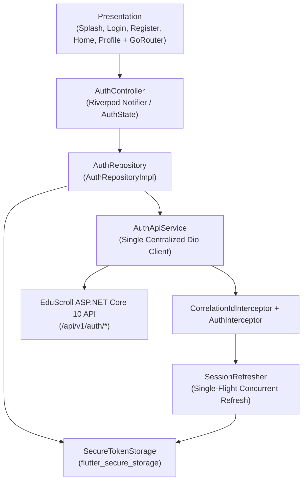

# EduScroll — Sprint 3 Completion Report
## Flutter Foundation & Authentication Integration

- **Project:** EduScroll (Educational Short-Video Discovery Platform)
- **Sprint:** 3 — Flutter Foundation
- **Branch:** `feature/sprint-3-flutter-foundation` (branched from `feature/sprint-2-database-auth`, preserving all Sprint 2 changes untouched)
- **Date:** 2026-11-25
- **Mobile Stack:** Flutter `3.41.4` (`stable`), Dart `3.11.1`, Riverpod (`flutter_riverpod 2.6.1`), Dio (`5.11.1`), GoRouter (`17.5.0`), `flutter_secure_storage` (`11.2.0`)
- **Backend Target:** ASP.NET Core 10 Web API (`backend/`) + Microsoft SQL Server + ASP.NET Core Identity + JWT Bearer & Refresh Token Rotation (with one targeted `Development`-only CORS update for Flutter Web dynamic `localhost` ports)

---

## 1. Executive Summary

Sprint 3 established the Flutter mobile foundation under `mobile/` and integrated it directly with the existing Sprint 2 ASP.NET Core 10 authentication API (`/api/v1/auth/register`, `/login`, `/refresh`, `/logout`, `/me`).

Key outcomes verified:
- **Backend contract alignment & Flutter Web CORS support:** All client DTOs, validators, token handling, and error mapping conform strictly to the verified Sprint 2 backend contracts. A targeted `Development`-only CORS update was added in `backend/src/EduScroll.API/Program.cs` (with integration test coverage) so Flutter Web's dynamic `localhost`/`127.0.0.1` ports pass browser CORS preflight while keeping `Production` and `Testing` strictly deny-by-default.
- **Clean, maintainable Flutter architecture** with strict static analysis (`strict-casts`, `strict-inference`, `strict-raw-types`, `avoid_print`, `unawaited_futures`).
- **Secure session lifecycle:** OS-encrypted token persistence (`flutter_secure_storage` v11), backend-timestamp expiration tracking (`expiresAtUtc` / `refreshTokenExpiresAtUtc`), single-flight concurrent refresh rotation (`SessionRefresher`), and fail-safe logout.
- **Verified quality & builds:** `flutter analyze` passed with `0` issues, `35 / 35` offline unit and widget tests passed, `1 / 1` live integration test passed against the real ASP.NET Core 10 API + SQL Server 2025 LocalDB (including 4-way concurrent refresh rotation), backend tests passed (`115 / 115`, including the new Development CORS preflight test), and Android (`app-debug.apk`), Windows (`eduscroll.exe`), and Web (`build\web`) builds all succeeded.

---

## 2. Repository & Environment Inspection

### Repository Findings
- No Flutter project existed prior to Sprint 3; scaffolded cleanly under `mobile/` alongside `backend/` and `docs/`.
- Verified actual backend contracts directly from `backend/src/EduScroll.API/Controllers/AuthController.cs` and `backend/src/EduScroll.Application/Authentication/Contracts/`:
  - `POST /api/v1/auth/register` returns `201 Created` (`UserProfileDto`, **no tokens**) -> Flutter displays confirmation and routes to Login with email prefilled.
  - `POST /api/v1/auth/login` and `POST /api/v1/auth/refresh` return `200 OK` (`AuthResponse`: `accessToken`, `tokenType`, `expiresAtUtc`, `refreshToken`, `refreshTokenExpiresAtUtc`, `user`).
  - `POST /api/v1/auth/logout` requires Bearer authentication (`[Authorize]`) and `{ "refreshToken": "..." }`.
  - `GET /api/v1/auth/me` requires Bearer authentication and returns `UserProfileDto` (`id`, `fullName`, `userName`, `email`, `createdAt`, `updatedAt`, `isActive`).
  - Backend `AllowedHosts` in `appsettings.Development.json` defaults to `localhost;127.0.0.1` (documented override for Android emulator `10.0.2.2` and LAN physical devices).

### Verified Local Flutter Toolchain
- **Flutter SDK:** `3.41.4` (`stable`, `C:\src\flutter`)
- **Dart SDK:** `3.11.1` (`windows_x64`)
- **Android SDK:** `36.1.0` (`C:\Users\Obad\AppData\Android\Sdk`), JDK `21.0.10`
- **Windows Toolchain:** Visual Studio Community 2026 (`18.10.0`), Windows 10 SDK (`10.0.26100.0`)
- **Connected Devices Available:** Windows desktop, Chrome, Edge (no booted Android emulator or physical mobile device connected; iOS requires macOS/Xcode)

---

## 3. Flutter Application Architecture



### Folder Layout (`mobile/lib/`)

```text
mobile/lib/
├── main.dart
├── app/
│   ├── app.dart                         # MaterialApp.router, light/dark themes, startup init
│   ├── config/app_config.dart           # Environment & API_BASE_URL (--dart-define) + prod HTTPS check
│   ├── router/app_router.dart           # GoRouter + reactive auth refresh + resolveAuthRedirect guard
│   └── theme/                           # AppColors, AppSpacing, AppTheme (Material 3 light & dark)
├── core/
│   ├── constants/api_endpoints.dart     # Verified Sprint 2 routes
│   ├── error/                           # AppFailure + RFC 9457 ProblemDetails ErrorMapper
│   ├── network/                         # ApiClientFactory, AuthInterceptor, CorrelationIdInterceptor
│   ├── storage/                         # SecureStorageService + SecureTokenStorage
│   ├── utils/validators.dart            # Client validation matching backend AuthRequestValidator
│   └── widgets/                         # AppLogo, PrimaryButton, SecondaryButton, AppTextField,
│                                        # PasswordField, LoadingIndicator, ErrorView, InlineMessageBanner, EmptyState
└── features/
    ├── authentication/
    │   ├── domain/                      # UserProfile, AuthTokens, AuthSession, LogoutResult, AuthRepository
    │   ├── data/                        # Models, AuthApiService, SessionRefresher, AuthRepositoryImpl
    │   └── presentation/                # AuthState, AuthController, auth_providers, AuthScaffold,
    │                                    # SplashScreen, LoginScreen, RegisterScreen
    ├── home/presentation/screens/       # HomeScreen (authenticated foundation + upcoming-feed empty state)
    └── profile/presentation/screens/    # ProfileScreen (live GET /api/v1/auth/me)
```

---

## 4. Dependencies Added

| Package | Version | Purpose |
|---|---|---|
| `dio` | `^5.11.1` | Centralized HTTP client, timeouts, interceptors, request cancellation |
| `flutter_riverpod` | `^2.6.1` | Compile-safe DI and reactive auth state (`ADR-005`) |
| `go_router` | `^17.5.0` | Declarative routing and centralized auth route guards |
| `flutter_secure_storage` | `^11.2.0` | OS-encrypted Keystore / Keychain / Credential Manager token storage |

---

## 5. Files Created & Modified

### Created
- **Flutter Project & Documentation:** `mobile/` scaffold (`android`, `ios`, `windows`, `web`), `mobile/README.md`
- **Android Network Security Configs:**
  - `mobile/android/app/src/main/res/xml/network_security_config.xml` (release/production HTTPS-only)
  - `mobile/android/app/src/debug/res/xml/network_security_config.xml` (debug-only cleartext exception strictly for `10.0.2.2`, `localhost`, `127.0.0.1`)
- **Application Source (`mobile/lib/` — 39 Dart files):** `main.dart`, `app/*`, `core/*`, `features/authentication/*`, `features/home/*`, `features/profile/*`
- **Automated Tests (`mobile/test/` — 11 Dart files):**
  - Helpers: `test/helpers/test_fakes.dart`
  - Unit tests: `app_config_test.dart`, `validators_test.dart`, `token_storage_test.dart`, `error_mapper_test.dart`, `session_refresher_and_interceptor_test.dart`, `auth_controller_test.dart`
  - Widget & app-flow tests: `login_screen_test.dart`, `register_screen_test.dart`, `app_flow_widget_test.dart`
  - Live backend integration test: `test/integration/real_backend_auth_test.dart`

### Modified
- `README.md` — documented `mobile/` workspace and linked `mobile/README.md`
- `docs/03-architecture/flutter-architecture.md` — updated to Sprint 3 implemented baseline
- Generated project files updated: `mobile/pubspec.yaml`, `mobile/analysis_options.yaml`, `mobile/android/app/src/main/AndroidManifest.xml`, `mobile/ios/Runner/Info.plist`
- **Targeted backend files modified (Flutter Web `Development` CORS support):**
  - `backend/src/EduScroll.API/Program.cs` — in `Development` only, updated the CORS policy via `SetIsOriginAllowed` to allow explicitly configured `Cors:AllowedOrigins` plus dynamic `http://`/`https://` `localhost` and `127.0.0.1` ports used by Flutter Web (never wildcard `*`, rejecting untrusted origins), and exposed `X-Correlation-Id` via `.WithExposedHeaders(...)`. `Production` and `Testing` remain strictly locked to explicit `Cors:AllowedOrigins`.
  - `backend/tests/EduScroll.API.IntegrationTests/Authentication/AuthEndpointsIntegrationTests.cs` — added `CorsPreflight_InDevelopment_ShouldAllowDynamicLocalhostPort_AndRejectUntrustedOrigin` to verify dynamic localhost preflights return `Access-Control-Allow-Origin` and untrusted origins are denied.

---

## 6. Key Implementation Details

### Design System & Screens
- **Theme:** Minimal modern educational palette (indigo primary `#2563EB`, teal secondary `#0D9488`, crisp slate surfaces) with full Material 3 light and dark theme foundations, responsive max widths (`440px` forms, `680px` content), keyboard-aware scrolling, `SafeArea`, accessible labels/tooltips, and `Wrap` footers preventing horizontal overflow on small screens and large accessibility text scales.
- **Startup Flow (`SplashScreen`):** Hydrates `SecureTokenStorage` on launch; routes directly to `/login` (no session) or `/home` (valid/refreshed session) without flicker; displays an explicit Retry + Sign-out view when the backend is unavailable while preserving valid local tokens.
- **Login & Register (`LoginScreen`, `RegisterScreen`):** Client-side validation aligned with backend `AuthRequestValidator` (including 6-unique-char password policy and strict email host checks), password visibility toggles, password confirmation, loading states, and inline + banner display of backend `400`/`401`/`403`/`409` errors (`DUPLICATE_EMAIL`, `DUPLICATE_USERNAME`, `INVALID_CREDENTIALS`, `ACCOUNT_LOCKED`, `ACCOUNT_INACTIVE`).
- **Home & Profile (`HomeScreen`, `ProfileScreen`):** Welcoming authenticated foundation shell (no fake video feed or AI UI) and read-only Profile screen backed by live `GET /api/v1/auth/me` displaying only verified DTO fields (`fullName`, `userName`, `email`, `isActive`, `createdAt`), pull-to-refresh, retry on error, and logout confirmation.

### Token, Network, Navigation & Security Controls
- **Single Centralized `Dio` Client:** Configured with timeouts (`15s` connect/send, `20s` receive), JSON headers, `CorrelationIdInterceptor` (`X-Correlation-Id`), and `AuthInterceptor`.
- **Single-Flight Concurrent Refresh (`SessionRefresher`):** Coalesces simultaneous `401`/expired-token triggers into a single `POST /api/v1/auth/refresh` call to stay safe against the backend's SQL Server `rowversion` optimistic concurrency lock.
- **Safe Retry Policy:** Skips public auth endpoints (`/login`, `/register`, `/refresh`), retries eligible idempotent calls (`GET`, `HEAD`, `OPTIONS`, `PUT`, `DELETE`, or explicit opt-in) at most once (`_authRetried`), and never blindly retries non-idempotent `POST` mutations.
- **Fail-Safe Logout:** Attempts server revocation via `POST /api/v1/auth/logout`, always clears local secure storage in `finally`, and displays an honest warning if server revocation could not be confirmed.
- **Security Hardening:** `flutter_secure_storage` v11 AES-GCM/RSA-OAEP Keystore & iOS Keychain `first_unlock_this_device`; redacted `toString()` on `AuthTokens` and request models; zero `print`/`debugPrint`/`SharedPreferences`/committed secrets; `android:allowBackup="false"`; production HTTPS-only enforcement in both `AppConfig` and Android `network_security_config.xml`.
- **Flutter Web `Development` CORS Fix:** Running `flutter run -d chrome`/`-d edge` binds an ephemeral `http://localhost:<port>` origin, causing browser CORS preflights (`OPTIONS /api/v1/auth/login`) to return `204` without `Access-Control-Allow-Origin` when `appsettings.Development.json` only listed port `3000`. Updated `backend/src/EduScroll.API/Program.cs` so `Development` allows explicit origins plus any `http(s)://localhost:<port>` or `http(s)://127.0.0.1:<port>` origin and exposes `X-Correlation-Id`, while preserving strict deny-by-default origin allowlisting in `Production` and `Testing`.

---

## 7. Verification, Tests & Build Results

### Static Analysis
- `flutter analyze`: **PASS** — `No issues found! (ran in 1.8s)`

### Automated Tests
- **Offline Unit & Widget Suite (`flutter test -r expanded`):** **35 / 35 Passed** (0 Failed; 1 live backend test skipped when `EDUSCROLL_LIVE_API_URL` is unset):
  - **Unit Tests (31 passed):** `AppConfig` (5), `AuthController` & `resolveAuthRedirect` (8), `ErrorMapper` (4), `SessionRefresher` & `AuthInterceptor` including 5-way concurrent 401 refresh coalescing (4), `SecureTokenStorage` & `AuthTokens` (4), `Validators` (6).
  - **Widget & App-Flow Tests (4 passed):** `LoginScreen` (1), `RegisterScreen` (1), end-to-end startup -> login -> home -> profile -> logout and expired-token restart recovery (2). *(Widget testing also surfaced and verified a fix for a horizontal `Row` overflow on `LoginScreen`/`RegisterScreen`.)*
- **Live Backend Integration Test (`test/integration/real_backend_auth_test.dart`):** **1 / 1 Passed** (`exit 0`) against the real ASP.NET Core 10 `EduScroll.API` + SQL Server 2025 LocalDB (`EduScroll_FlutterE2E`, dropped after test), verifying real `register`, `409 DUPLICATE_EMAIL`, `401 INVALID_CREDENTIALS`, `login`, `GET /me`, `restoreSession`, 4-way concurrent single-flight refresh rotation against SQL Server `rowversion`, revoked token rejection, and `logout`.
- **Backend Automated Test Suite (`dotnet test backend/EduScroll.sln`):** **115 / 115 Passed** (`0` Failed — 16 Domain, 42 Application, 5 Architecture, 52 API Integration including `CorsPreflight_InDevelopment_ShouldAllowDynamicLocalhostPort_AndRejectUntrustedOrigin`).
- **Live Flutter Web CORS Smoke Verification:** Confirmed against `http://localhost:5221` in `Development` that `OPTIONS /api/v1/auth/login` and `POST /api/v1/auth/login` with `Origin: http://localhost:58392` and `X-Correlation-Id` return `Access-Control-Allow-Origin: http://localhost:58392` and `Access-Control-Expose-Headers: X-Correlation-Id`, while `Origin: https://evil.example.com` receives no `Access-Control-Allow-Origin` header.

### Platform Builds
- `flutter build apk --debug`: **PASS** (`√ Built build\app\outputs\flutter-apk\app-debug.apk`, exit `0`)
- `flutter build windows --debug`: **PASS** (`√ Built build\windows\x64\runner\Debug\eduscroll.exe`, exit `0`)
- `flutter build web --dart-define=APP_ENV=development --dart-define=API_BASE_URL=http://localhost:5221`: **PASS** (`√ Built build\web`, exit `0`)

---

## 8. Sprint 3 Acceptance Criteria

| ID | Requirement | Status | Evidence |
|---|---|---|---|
| S3-01 | Flutter project exists and builds | **PASS** | `mobile/` created; Android debug APK, Windows debug exe, and Web (`build\web`) built with exit `0`. |
| S3-02 | Architecture is established | **PASS** | Feature-first layered structure (`app/`, `core/`, `features/`). |
| S3-03 | Environment configuration works | **PASS** | `AppConfig` dev/test/prod + HTTPS check verified (5 unit tests). |
| S3-04 | Central API client works | **PASS** | Single shared `Dio` client verified in unit, widget, and live backend tests. |
| S3-05 | Secure token storage works | **PASS** | `SecureTokenStorage` + `PlatformSecureStorageService` (`flutter_secure_storage` v11) verified in unit & integration tests. |
| S3-06 | Login UI is implemented | **PASS** | Verified in `login_screen_test.dart` and `app_flow_widget_test.dart`. |
| S3-07 | Login connects to the real backend | **PASS** | Verified live in `real_backend_auth_test.dart` (`401` + `200`). |
| S3-08 | Register UI is implemented | **PASS** | Verified in `register_screen_test.dart`. |
| S3-09 | Register connects to the real backend | **PASS** | Verified live in `real_backend_auth_test.dart` (`201` + `409`). |
| S3-10 | JWT authentication works | **PASS** | Verified live Bearer requests to `/api/v1/auth/me` and `/logout`. |
| S3-11 | Session persistence works | **PASS** | Verified in `token_storage_test.dart`, `app_flow_widget_test.dart`, and `real_backend_auth_test.dart`. |
| S3-12 | Current user retrieval works | **PASS** | Verified live `GET /api/v1/auth/me` and `ProfileScreen` widget flow. |
| S3-13 | Session refresh works | **PASS** | Verified rotation and old-token rejection offline and against real SQL Server. |
| S3-14 | Concurrent refresh is handled safely | **PASS** | Verified 5-way unit coalescing + 4-way live concurrent rotation against SQL Server `rowversion`. |
| S3-15 | Logout works | **PASS** | Verified live server revocation, local token clearing, and honest offline warning. |
| S3-16 | Navigation guards work | **PASS** | Verified `resolveAuthRedirect` matrix + `GoRouter` redirect flows. |
| S3-17 | Home foundation is implemented | **PASS** | Verified `HomeScreen` greeting, profile nav, logout, and empty-state foundation. |
| S3-18 | Profile screen is implemented | **PASS** | Verified `ProfileScreen` loading, verified fields only, retry, and logout. |
| S3-19 | Error handling works | **PASS** | Verified `ErrorMapper` across network, timeout, `ProblemDetails`, and malformed JSON. |
| S3-20 | Unit tests pass | **PASS** | 31 / 31 unit tests passed. |
| S3-21 | Widget tests pass | **PASS** | 4 / 4 widget & app-flow tests passed. |
| S3-22 | Flutter analyze passes | **PASS** | `flutter analyze`: `No issues found!`. |
| S3-23 | No tokens or secrets are exposed | **PASS** | Redacted `toString()`, zero `print`/`SharedPreferences`/secrets, prod HTTPS-only. |
| S3-24 | Documentation is updated | **PASS** | Created `mobile/README.md`; updated `README.md` and `docs/03-architecture/flutter-architecture.md`. |

---

## 9. Known Issues, Untested & Blocked Items

- **Interactive Android Emulator / Physical Device Run (`NOT TESTED`):** No Android emulator or physical device was booted during this session; interactive UI & Android Keystore hardware-backed storage verification should be performed on an emulator/device when launched.
- **iOS Build (`BLOCKED`):** Requires macOS and Xcode (current workstation runs Windows 11).
- **Local Android SDK Notice:** `flutter doctor` noted unaccepted Android SDK licenses (`flutter doctor --android-licenses`) and an `ANDROID_HOME` typo (`AppDatal` vs `AppData`), though `ANDROID_SDK_ROOT` is valid and `flutter build apk --debug` succeeded cleanly.

---

## 10. Quick-Start Run & Android Commands

```powershell
# 1. Start SQL Server LocalDB & Backend API (Android emulator host compatible)
sqllocaldb start MSSQLLocalDB
cd backend
$env:AllowedHosts = "localhost;127.0.0.1;10.0.2.2"
$env:HttpsRedirection__Enabled = "false"
dotnet run --project src/EduScroll.API/EduScroll.API.csproj --urls http://0.0.0.0:5221

# 2. Run Flutter App
cd ../mobile
flutter pub get
flutter run -d chrome --dart-define=APP_ENV=development --dart-define=API_BASE_URL=http://localhost:5221  # Web (Chrome)
flutter run -d windows       # Windows desktop (uses http://localhost:5221)
flutter run                  # Android emulator (uses http://10.0.2.2:5221)

# 3. Physical Android device on local Wi-Fi (add LAN IP to backend AllowedHosts)
flutter run --dart-define=APP_ENV=development --dart-define=API_BASE_URL=http://192.168.1.25:5221

# 4. Verify Analysis & Tests
flutter analyze
flutter test
```

---

## 11. Recommended Next Sprint

**Sprint 4 — Source Ingestion & Content Extraction:**
- Flutter on-device PDF file selection and off-UI-thread text extraction (`WF-02` / `WF-03`, sending UTF-8 text only).
- Web URL submission flow in Flutter + backend SSRF-hardened `IWebContentFetcher`, `Source` entity/migrations, and strict `OwnerUserId == JwtSub` authorization (`SEC-003`, `SEC-006`).
